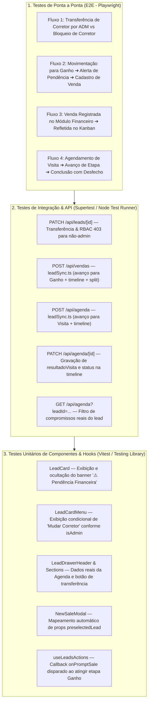

# 🧪 Plano de Testes Automatizados — Sincronização Bidirecional & Novas Melhorias

> **Escopo:** Validação automatizada e regressiva das novas capacidades do Connect Platz CRM:
> 1. **Transferência de Corretor (Change Broker)** com barreira estrita de RBAC (`ADMINISTRADOR`).
> 2. **Alerta de Pendência Financeira** em cards e prontuário de leads em etapa "Ganho" sem venda.
> 3. **Abertura Ágil e Pré-preenchimento do Modal de Venda** (`NewSaleModal`).
> 4. **Sincronização Vendas ➔ Kanban** (fechamento automático de etapa e gravação de histórico).
> 5. **Sincronização Agenda ➔ Kanban & Prontuário** (avanço de etapa de Visita/Proposta, consulta real de compromissos no Drawer e registro de desfecho na timeline).

---

## 🏗️ 1. Matriz de Cobertura e Pirâmide de Testes



---

## 📡 2. Camada de Testes de API & Integração de Backend

### TC-API-01: Transferência de Corretor com Perfil ADMINISTRADOR
- **Arquivo de Teste:** `tests/api/leads/change-broker.test.ts`
- **Endpoint:** `PATCH /api/leads/:id`
- **Cenário:** Administrador autenticado transfere o lead para outro corretor ativo.
- **Payload:**
  ```json
  { "corretorId": "e2f1a34b-c567-4890-a123-456789abcdef" }
  ```
- **Asserções:**
  1. Status HTTP retornado deve ser `200 OK`.
  2. `lead.corretorId` atualizado para o novo ID no banco de dados.
  3. `lead.isBolsao` deve ser `false`.
  4. Nova entrada gerada na tabela `lead_timeline` com:
     - `tipo === "transbordo"`
     - Conteúdo contendo o nome do corretor anterior e o nome do novo corretor.
  5. Registro gravado na tabela `auditoria` com ação `"Lead atualizado"`.

### TC-API-02: Bloqueio de Transferência por Usuário CORRETOR (RBAC)
- **Arquivo de Teste:** `tests/api/leads/change-broker-rbac.test.ts`
- **Endpoint:** `PATCH /api/leads/:id`
- **Cenário:** Usuário com role `CORRETOR` tenta alterar o `corretorId` de um lead.
- **Asserções:**
  1. Status HTTP retornado deve ser `403 Forbidden`.
  2. Mensagem de erro: `"Apenas administradores podem transferir leads entre corretores."`.
  3. O campo `corretorId` do lead no banco de dados permanece inalterado.
  4. Nenhuma entrada de transferência na timeline.

---

### TC-API-03: Sincronização Automática ao Registrar Venda (Vendas ➔ Kanban)
- **Arquivo de Teste:** `tests/api/vendas/lead-sync.test.ts`
- **Endpoint:** `POST /api/vendas`
- **Cenário:** Venda cadastrada com `leadId` de um lead que está na etapa inicial ("Novo Lead").
- **Asserções:**
  1. Status HTTP retornado deve ser `201 Created`.
  2. A venda é registrada com sucesso (`Sale` e `CommissionSplit` criados).
  3. O lead associado tem seu campo `stageId` atualizado para o ID da etapa de "Ganho" ou "Fechado" do seu funil.
  4. O campo `lead.slaBreached` é resetado para `false`.
  5. É inserido um registro na `lead_timeline` com:
     - `tipo === "venda"`
     - `conteudo` contendo código da venda (`VEN-AAAA-XXXX`), nome do empreendimento e VGV formatado.
     - `metadata` contendo `saleId`, `codigoVenda`, `vgv` e `comissaoBruta`.

---

### TC-API-04: Sincronização de Agendamento de Visita (Agenda ➔ Kanban)
- **Arquivo de Teste:** `tests/api/agenda/lead-sync.test.ts`
- **Endpoint:** `POST /api/agenda`
- **Cenário:** Criação de compromisso com `tipo: "VISITA"` vinculado a um lead na etapa "Novo Lead" (posição inferior à etapa de visita).
- **Asserções:**
  1. Status HTTP retornado deve ser `201 Created`.
  2. O lead é movido automaticamente para a etapa com nome contendo "Visita" (ex: "Visita Agendada").
  3. Linha do tempo do lead recebe evento com:
     - `tipo === "visita"`
     - Data e horário legíveis em pt-BR.
     - Confirmação do avanço de etapa: `• Lead avançado no funil para "Visita Agendada"`.
  4. Score do lead recalculado via `refreshLeadScore`.

---

### TC-API-05: Conclusão de Visita com Registro de Desfecho na Timeline
- **Arquivo de Teste:** `tests/api/agenda/appointment-completion.test.ts`
- **Endpoint:** `PATCH /api/agenda/:id`
- **Cenário:** Atualização do status de um agendamento existente de `AGENDADO` para `CONCLUIDO` com anotações de desfecho.
- **Payload:**
  ```json
  {
    "status": "CONCLUIDO",
    "resultadoVisita": "Cliente adorou a planta de 3 quartos, solicitou simulação com 30% de entrada."
  }
  ```
- **Asserções:**
  1. Status HTTP retornado deve ser `200 OK`.
  2. Registro gravado na tabela `lead_timeline` contendo:
     - `tipo === "status_change"`
     - Texto com o nome do usuário que concluiu e o `resultadoVisita`.
     - `metadata` preservando `{ appointmentId, status: "CONCLUIDO", resultadoVisita }`.

---

### TC-API-06: Consulta de Compromissos Reais do Lead no Drawer
- **Arquivo de Teste:** `tests/api/agenda/lead-appointments.test.ts`
- **Endpoint:** `GET /api/agenda?leadId=:leadId`
- **Cenário:** Consulta de compromissos passando o parâmetro `leadId`.
- **Asserções:**
  1. Status HTTP retornado deve ser `200 OK`.
  2. Todos os itens retornados na lista `appointments` devem pertencer exclusivamente ao `leadId` informado.
  3. A resposta inclui relacionamentos `user`, `lead` e `property`.

---

## 🧩 3. Camada de Testes Unitários de Componentes & Hooks

| ID | Componente / Hook | Caso de Teste | Condição & Resultado Esperado |
|---|---|---|---|
| **TC-UNIT-01** | `LeadCard.tsx` | Alerta de Pendência Financeira (Exibição) | Quando `lead.stage.nome` contém `"ganho"` e `lead.salesCount === 0`, o card DEVE renderizar o elemento `⚠️ Pendência Financeira` e o botão `"Cadastrar Venda"`. |
| **TC-UNIT-02** | `LeadCard.tsx` | Alerta de Pendência Financeira (Ocultação) | Quando `lead.salesCount >= 1`, o banner de pendência financeira NÃO DEVE existir no DOM. |
| **TC-UNIT-03** | `LeadCardMenu.tsx` | Permissão no Menu (Administrador) | Com prop `isAdmin={true}`, a opção com texto `"Mudar corretor"` DEVE estar visível e disparar `onChangeBroker(lead)` ao ser clicada. |
| **TC-UNIT-04** | `LeadCardMenu.tsx` | Permissão no Menu (Corretor) | Com prop `isAdmin={false}`, a opção `"Mudar corretor"` NÃO DEVE ser renderizada no menu. |
| **TC-UNIT-05** | `LeadDrawerHeader.tsx` | Botão Mudar Corretor no Drawer | Com `isAdmin={true}`, o avatar/nome do corretor exibe o botão `"Mudar corretor"`. Com `isAdmin={false}`, exibe apenas o nome e avatar estático. |
| **TC-UNIT-06** | `LeadDetailsSections.tsx` | Carregamento de Agenda Real | Ao abrir o componente com `lead.id`, dispara chamada `GET /api/agenda?leadId=...` e renderiza os cards com data/hora e badge do tipo (`VISITA`, `LEMBRETE`). |
| **TC-UNIT-07** | `NewSaleModal.tsx` | Pré-preenchimento via `preselectedLead` | Quando aberto com um lead pré-selecionado, os campos de comprador (`compradorNome`), corretor titular (`corretorId`) e busca do imóvel de interesse devem vir preenchidos automaticamente. |
| **TC-UNIT-08** | `useLeadsActions.ts` | Gatilho `onPromptSale` ao mover etapa | Ao invocar `moveToStage(leadId, "etapa-ganho-id")` em um lead sem vendas, o hook deve disparar o callback `onPromptSale(lead)` para abrir o modal de venda. |

---

## 🎭 4. Camada de Testes de Ponta a Ponta (E2E — Playwright)

### Especificação E2E-01: Troca de Corretor pelo Administrador
```typescript
test("Administrador deve conseguir transferir um lead de corretor com sucesso", async ({ page }) => {
  // 1. Login como Administrador
  await loginAs(page, "admin@connectplatz.com.br", "senha123");
  await page.goto("/crm/leads");

  // 2. Localiza o primeiro card do Kanban e abre o menu de contexto
  const firstCard = page.locator("[data-testid='lead-card']").first();
  await firstCard.locator("button[aria-label='Opções do lead']").click();

  // 3. Clica em 'Mudar corretor'
  await page.getByRole("menuitem", { name: /mudar corretor/i }).click();

  // 4. Modal 'Transferir Lead de Corretor' deve abrir
  const modal = page.locator("[role='dialog']");
  await expect(modal).toBeVisible();
  await expect(modal.getByText("Transferir Lead de Corretor")).toBeVisible();

  // 5. Seleciona o novo corretor na lista e confirma
  await modal.locator("input[placeholder*='Buscar corretor']").fill("Marina Silva");
  await modal.getByText("Marina Silva").click();
  await modal.getByRole("button", { name: /confirmar transferência/i }).click();

  // 6. Valida toast de sucesso e atualização visual
  await expect(page.getByText(/lead transferido com sucesso para Marina Silva/i)).toBeVisible();
  await expect(firstCard.getByText("Marina Silva")).toBeVisible();
});
```

---

### Especificação E2E-02: Fluxo Completo de Ganho com Pendência Financeira e Cadastro de Venda
```typescript
test("Arrastar lead para Ganho deve alertar pendência e permitir cadastro de venda ágil", async ({ page }) => {
  await loginAs(page, "admin@connectplatz.com.br", "senha123");
  await page.goto("/crm/leads");

  const leadCard = page.locator("[data-testid='lead-card']").first();
  const leadName = await leadCard.locator("h4").innerText();
  const ganhoColumn = page.locator("[data-testid='kanban-column-ganho']");

  // 1. Arrasta o lead para a coluna de Ganho
  await leadCard.dragTo(ganhoColumn);

  // 2. Modal de Nova Venda deve abrir automaticamente sugerido pelo sistema
  const saleModal = page.locator("[data-testid='new-sale-modal']");
  await expect(saleModal).toBeVisible();

  // 3. Simula fechamento sem preencher para validar persistência da pendência
  await saleModal.getByRole("button", { name: /cancelar/i }).click();

  // 4. O lead deve permanecer na coluna de Ganho com o alerta de Pendência Financeira
  const wonCard = ganhoColumn.locator(`text=${leadName}`).locator("..");
  await expect(wonCard.getByText("Pendência Financeira")).toBeVisible();
  const btnCadastrarVenda = wonCard.getByRole("button", { name: /cadastrar venda/i });
  await expect(btnCadastrarVenda).toBeVisible();

  // 5. Clica no botão de ação rápida 'Cadastrar Venda'
  await btnCadastrarVenda.click();
  await expect(saleModal).toBeVisible();

  // 6. Preenche os dados da venda e salva
  await saleModal.locator("input[name='vgv']").fill("450000");
  await saleModal.getByRole("button", { name: /salvar e emitir contrato/i }).click();

  // 7. Valida que o alerta de pendência financeira sumiu após o registro da venda
  await expect(page.getByText(/venda registrada com sucesso/i)).toBeVisible();
  await expect(wonCard.getByText("Pendência Financeira")).not.toBeVisible();
});
```

---

### Especificação E2E-03: Sincronização Vendas e Comissões ➔ Kanban
```typescript
test("Fechar venda pelo módulo de Vendas deve mover automaticamente o lead para Ganho", async ({ page }) => {
  await loginAs(page, "admin@connectplatz.com.br", "senha123");

  // 1. Acessa o módulo de Vendas e Comissões
  await page.goto("/crm/vendas");
  await page.getByRole("button", { name: /novo contrato/i }).click();

  // 2. Seleciona um lead que está ativo em etapa anterior no Kanban
  const saleModal = page.locator("[data-testid='new-sale-modal']");
  await saleModal.locator("[data-testid='select-lead']").click();
  await page.getByRole("option", { name: "Roberto Firmino" }).click();
  await saleModal.locator("input[name='vgv']").fill("600000");
  await saleModal.getByRole("button", { name: /salvar e emitir contrato/i }).click();

  await expect(page.getByText(/venda registrada com sucesso/i)).toBeVisible();

  // 3. Retorna ao Kanban de Leads e valida a posição do lead
  await page.goto("/crm/leads");
  const ganhoColumn = page.locator("[data-testid='kanban-column-ganho']");
  await expect(ganhoColumn.getByText("Roberto Firmino")).toBeVisible();

  // 4. Abre o Drawer e valida a timeline
  await ganhoColumn.getByText("Roberto Firmino").click();
  const drawer = page.locator("[data-testid='lead-drawer']");
  await expect(drawer.getByText(/Venda VEN-.*registrada com sucesso/i)).toBeVisible();
});
```

---

### Especificação E2E-04: Sincronização Agenda ➔ Avanço no Funil & Histórico
```typescript
test("Agendar visita deve avançar o lead para 'Visita Agendada' e registrar histórico", async ({ page }) => {
  await loginAs(page, "corretor@connectplatz.com.br", "senha123");
  await page.goto("/crm/agenda");

  // 1. Cadastra novo compromisso do tipo Visita
  await page.getByRole("button", { name: /\+ novo/i }).click();
  const modal = page.locator("[role='dialog']");
  await modal.locator("select[name='tipo']").selectOption("VISITA");
  await modal.locator("input[name='titulo']").fill("Visita Decorado Reserva das Flores");
  await modal.locator("input[placeholder*='Buscar cliente']").fill("Juliana Paes");
  await page.getByText("Juliana Paes").click();
  await modal.getByRole("button", { name: /criar compromisso/i }).click();

  await expect(page.getByText(/compromisso agendado com sucesso/i)).toBeVisible();

  // 2. Navega para o Kanban e confirma que Juliana Paes está na etapa de Visita
  await page.goto("/crm/leads");
  const visitaColumn = page.locator("[data-testid='kanban-column-visita']");
  await expect(visitaColumn.getByText("Juliana Paes")).toBeVisible();

  // 3. Abre o Drawer e valida que o compromisso consta na aba de compromissos
  await visitaColumn.getByText("Juliana Paes").click();
  const drawer = page.locator("[data-testid='lead-drawer']");
  await expect(drawer.getByText("Visita Decorado Reserva das Flores")).toBeVisible();
});
```

---

## 🚀 5. Script Executável de Teste Automatizado de Integração

Pode ser executado via CLI local ou pipeline de CI (`node scripts/test-leads-bidirectional-sync.mjs`):

```javascript
// scripts/test-leads-bidirectional-sync.mjs
import assert from "node:assert/strict";

const BASE_URL = process.env.TEST_BASE_URL || "http://localhost:3000";

async function runTest(name, fn) {
  process.stdout.write(`⏳ Executando: ${name}... `);
  try {
    await fn();
    console.log("✅ PASSOU");
  } catch (err) {
    console.log("❌ FALHOU");
    console.error(err);
    process.exitCode = 1;
  }
}

async function main() {
  console.log("\n🧪 INICIANDO BATERIA DE TESTES DE SINCRONIZAÇÃO BIDIRECIONAL\n");

  let adminToken, corretorToken, testLeadId;

  await runTest("Autenticação de Administrador", async () => {
    const res = await fetch(`${BASE_URL}/api/auth/login`, {
      method: "POST",
      headers: { "Content-Type": "application/json" },
      body: JSON.stringify({ email: "admin@connectplatz.com.br", password: process.env.ADMIN_PASSWORD }),
    });
    assert.equal(res.status, 200);
    const cookie = res.headers.get("set-cookie");
    adminToken = cookie.split(";")[0];
  });

  await runTest("Autenticação de Corretor Comum", async () => {
    const res = await fetch(`${BASE_URL}/api/auth/login`, {
      method: "POST",
      headers: { "Content-Type": "application/json" },
      body: JSON.stringify({ email: "corretor@connectplatz.com.br", password: process.env.CORRETOR_PASSWORD }),
    });
    assert.equal(res.status, 200);
    const cookie = res.headers.get("set-cookie");
    corretorToken = cookie.split(";")[0];
  });

  await runTest("Criação de Lead de Teste para o Funil", async () => {
    const res = await fetch(`${BASE_URL}/api/leads`, {
      method: "POST",
      headers: { "Content-Type": "application/json", Cookie: adminToken },
      body: JSON.stringify({
        nome: "Teste Automatizado Sincronizacao",
        telefone: "11988887777",
        email: "teste.sync@connectplatz.com.br",
      }),
    });
    assert.equal(res.status, 201);
    const data = await res.json();
    testLeadId = data.lead.id;
    assert.ok(testLeadId);
  });

  await runTest("Bloqueio de Transferência de Corretor por Não-Administrador (HTTP 403)", async () => {
    const res = await fetch(`${BASE_URL}/api/leads/${testLeadId}`, {
      method: "PATCH",
      headers: { "Content-Type": "application/json", Cookie: corretorToken },
      body: JSON.stringify({ corretorId: "00000000-0000-0000-0000-000000000001" }),
    });
    assert.equal(res.status, 403);
  });

  await runTest("Sincronização de Visita: Agendamento move lead para Etapa de Visita", async () => {
    const res = await fetch(`${BASE_URL}/api/agenda`, {
      method: "POST",
      headers: { "Content-Type": "application/json", Cookie: adminToken },
      body: JSON.stringify({
        tipo: "VISITA",
        titulo: "Visita Teste Automatizado",
        dataInicio: new Date(Date.now() + 86400000).toISOString(),
        dataFim: new Date(Date.now() + 90000000).toISOString(),
        leadId: testLeadId,
      }),
    });
    assert.equal(res.status, 201);

    // Consulta se o lead avançou para a etapa de Visita
    const leadRes = await fetch(`${BASE_URL}/api/leads/${testLeadId}`, {
      headers: { Cookie: adminToken },
    });
    const leadData = await leadRes.json();
    assert.match(leadData.lead.stage.nome.toLowerCase(), /visit/);
  });

  await runTest("Sincronização de Venda: Registro move lead para Etapa de Ganho e zera SLA", async () => {
    const res = await fetch(`${BASE_URL}/api/vendas`, {
      method: "POST",
      headers: { "Content-Type": "application/json", Cookie: adminToken },
      body: JSON.stringify({
        leadId: testLeadId,
        propertyId: "11111111-1111-1111-1111-111111111111", // ID mock ou seed
        vgv: 500000,
        percentualComissao: 5,
        dataVenda: new Date().toISOString().slice(0, 10),
        meioPagamento: "PIX",
        participants: [],
      }),
    });
    assert.equal(res.status, 201);

    const leadRes = await fetch(`${BASE_URL}/api/leads/${testLeadId}`, {
      headers: { Cookie: adminToken },
    });
    const leadData = await leadRes.json();
    assert.match(leadData.lead.stage.nome.toLowerCase(), /vend|fechad|ganh/);
    assert.equal(leadData.lead.slaBreached, false);
    assert.ok(leadData.lead.salesCount >= 1);
  });

  console.log("\n🎉 TODOS OS TESTES DE SINCRONIZAÇÃO PASSARAM COM SUCESSO!\n");
}

main().catch(console.error);
```

---

## 📊 6. Critérios de Aceite e Regras de Qualidade CI/CD

1. **RBAC Inviolável:** Nenhuma rota que altere atribuição de carteira ou dados financeiros pode responder com `200` sem credencial de `ADMINISTRADOR`.
2. **Determinismo Total:** Todos os gatilhos de avanço de etapa e alertas de pendência financeira calculados deterministicamente no banco (`salesCount` e ordem `posicao` das etapas), sem dependência de serviços externos.
3. **Integridade da Linha do Tempo:** Todas as transições geram obrigatoriamente um registro em `lead_timeline` para rastreabilidade de compliance.
4. **Respeito aos Limites de Linhas:** Nenhum arquivo de implementação ou componente de teste ultrapassa o teto de 350–400 linhas.
