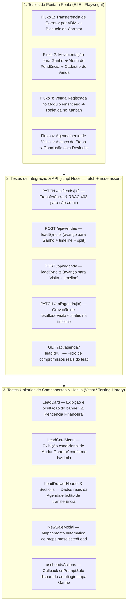

# 🧪 Plano de Testes Automatizados — Sincronização Bidirecional & Novas Melhorias

> **Escopo:** Validação automatizada e regressiva das novas capacidades do Connect Platz CRM:
> 1. **Transferência de Corretor (Change Broker)** com barreira estrita de RBAC (`ADMINISTRADOR`).
> 2. **Alerta de Pendência Financeira** em cards e prontuário de leads em etapa "Ganho" sem venda.
> 3. **Abertura Ágil e Pré-preenchimento do Modal de Venda** (`NewSaleModal`).
> 4. **Sincronização Vendas ➔ Kanban** (fechamento automático de etapa e gravação de histórico).
> 5. **Sincronização Agenda ➔ Kanban & Prontuário** (avanço de etapa de Visita/Proposta, consulta real de compromissos no Drawer e registro de desfecho na timeline).

---

## 🏗️ 1. Matriz de Cobertura e Pirâmide de Testes



---

## 📡 2. Camada de Testes de API & Integração de Backend

### TC-API-01: Transferência de Corretor com Perfil ADMINISTRADOR
- **Arquivo de Teste:** `scripts/test-leads-bidirectional-sync.mjs`
- **Endpoint:** `PATCH /api/leads/:id`
- **Cenário:** Administrador autenticado transfere o lead para outro corretor ativo.
- **Payload:**
  ```json
  { "corretorId": "e2f1a34b-c567-4890-a123-456789abcdef" }
  ```
- **Asserções:**
  1. Status HTTP retornado deve ser `200 OK`.
  2. `lead.corretorId` atualizado para o novo ID no banco de dados.
  3. `lead.isBolsao` deve ser `false`.
  4. Nova entrada gerada na tabela `lead_timeline` com:
     - `tipo === "transbordo"`
     - Conteúdo contendo o nome do corretor anterior e o nome do novo corretor.
  5. Registro gravado na tabela `auditoria` com ação `"LEAD_ATUALIZADO"` (`entidadeId` = id do lead).

### TC-API-02: Bloqueio de Transferência por Usuário CORRETOR (RBAC)
- **Arquivo de Teste:** `scripts/test-leads-bidirectional-sync.mjs`
- **Endpoint:** `PATCH /api/leads/:id`
- **Cenário:** Usuário com role `CORRETOR` tenta alterar o `corretorId` de um lead que pertence à sua carteira.
- **Asserções:**
  1. Status HTTP retornado deve ser `403 Forbidden`.
  2. Mensagem de erro contendo `"administradores"` (ex: `"Somente administradores podem trocar o corretor do lead."`).
  3. O campo `corretorId` do lead no banco de dados permanece inalterado.
  4. Nenhuma entrada de transferência na timeline.

---

### TC-API-03: Sincronização Automática ao Registrar Venda (Vendas ➔ Kanban)
- **Arquivo de Teste:** `scripts/test-leads-bidirectional-sync.mjs`
- **Endpoint:** `POST /api/vendas`
- **Cenário:** Venda cadastrada com `leadId` de um lead que está na etapa inicial ("Novo Lead").
- **Asserções:**
  1. Status HTTP retornado deve ser `201 Created`.
  2. A venda é registrada com sucesso (`Sale` e `CommissionSplit` criados).
  3. O lead associado tem seu campo `stageId` atualizado para o ID da etapa de "Ganho" ou "Fechado" do seu funil.
  4. O campo `lead.slaBreached` é resetado para `false`.
  5. É inserido um registro na `lead_timeline` com:
     - `tipo === "venda"`
     - `conteudo` contendo código da venda (`CP-AAAA-NNN`, ex: `CP-2026-001`), nome do empreendimento e VGV formatado.
     - `metadata` contendo `saleId`, `codigoVenda`, `vgv` e `comissaoBruta`.

---

### TC-API-04: Sincronização de Agendamento de Visita (Agenda ➔ Kanban)
- **Arquivo de Teste:** `scripts/test-leads-bidirectional-sync.mjs`
- **Endpoint:** `POST /api/agenda`
- **Cenário:** Criação de compromisso com `tipo: "VISITA"` vinculado a um lead na etapa "Novo Lead" (posição inferior à etapa de visita).
- **Asserções:**
  1. Status HTTP retornado deve ser `201 Created`.
  2. O lead é movido automaticamente para a etapa com nome contendo "Visita" (ex: "Visita Agendada").
  3. Linha do tempo do lead recebe evento com:
     - `tipo === "visita"`
     - Data e horário legíveis em pt-BR.
     - Confirmação do avanço de etapa: `• Lead avançado no funil para "Visita Agendada"`.
  4. Score do lead recalculado via `refreshLeadScore`.

---

### TC-API-05: Conclusão de Visita com Registro de Desfecho na Timeline
- **Arquivo de Teste:** `scripts/test-leads-bidirectional-sync.mjs`
- **Endpoint:** `PATCH /api/agenda/:id`
- **Cenário:** Atualização do status de um agendamento existente de `AGENDADO` para `CONCLUIDO` com anotações de desfecho.
- **Payload:**
  ```json
  {
    "status": "CONCLUIDO",
    "resultadoVisita": "Cliente adorou a planta de 3 quartos, solicitou simulação com 30% de entrada."
  }
  ```
- **Asserções:**
  1. Status HTTP retornado deve ser `200 OK`.
  2. Registro gravado na tabela `lead_timeline` contendo:
     - `tipo === "status_change"`
     - Texto com o nome do usuário que concluiu e o `resultadoVisita`.
     - `metadata` preservando `{ appointmentId, status: "CONCLUIDO", resultadoVisita }`.

---

### TC-API-06: Consulta de Compromissos Reais do Lead no Drawer
- **Arquivo de Teste:** `scripts/test-leads-bidirectional-sync.mjs`
- **Endpoint:** `GET /api/agenda?leadId=:leadId`
- **Cenário:** Consulta de compromissos passando o parâmetro `leadId`.
- **Asserções:**
  1. Status HTTP retornado deve ser `200 OK`.
  2. Todos os itens retornados na lista `appointments` devem pertencer exclusivamente ao `leadId` informado.
  3. A resposta inclui relacionamentos `user`, `lead` e `property`.

---

## 🧩 3. Camada de Testes Unitários de Componentes & Hooks

| ID | Componente / Hook | Caso de Teste | Condição & Resultado Esperado |
|---|---|---|---|
| **TC-UNIT-01** | `LeadCard.tsx` | Alerta de Pendência Financeira (Exibição) | Quando `lead.stage.nome` contém `"ganho"` e `lead.salesCount === 0`, o card DEVE renderizar o elemento `⚠️ Pendência Financeira` e o botão `"Cadastrar Venda"`. |
| **TC-UNIT-02** | `LeadCard.tsx` | Alerta de Pendência Financeira (Ocultação) | Quando `lead.salesCount >= 1`, o banner de pendência financeira NÃO DEVE existir no DOM. |
| **TC-UNIT-03** | `LeadCardMenu.tsx` | Permissão no Menu (Administrador) | Com prop `isAdmin={true}`, a opção com texto `"Mudar corretor"` DEVE estar visível e disparar `onChangeBroker(lead)` ao ser clicada. |
| **TC-UNIT-04** | `LeadCardMenu.tsx` | Permissão no Menu (Corretor) | Com prop `isAdmin={false}`, a opção `"Mudar corretor"` NÃO DEVE ser renderizada no menu. |
| **TC-UNIT-05** | `LeadDrawerHeader.tsx` | Botão Mudar Corretor no Drawer | Com `isAdmin={true}`, ao lado de `Responsável: <nome do corretor>` aparece o botão `"Mudar corretor"`, que chama `onChangeBroker(lead)`. Com `isAdmin={false}` (padrão), exibe apenas o texto do responsável. (`tests/unit/LeadDrawerHeader.test.tsx`) |
| **TC-UNIT-06** | `LeadDetailsSections.tsx` | Carregamento de Agenda Real | Ao montar com `lead`, chama `fetch('/api/agenda?leadId=<lead.id>')` e renderiza cada compromisso com título, `dd/mm/aaaa às hh:mm` e badge do tipo (`VISITA` → "Visita", `FOLLOW_UP` → "Retorno / Follow-up"; demais tipos aparecem crus, ex. "LEMBRETE"). (`tests/unit/LeadDetailsSections.test.tsx`) |
| **TC-UNIT-07** | `NewSaleModal.tsx` | Pré-preenchimento via `preselectedLead` | Quando aberto com um lead pré-selecionado, os campos de comprador (`compradorNome`), corretor titular (`corretorId`) e busca do imóvel de interesse devem vir preenchidos automaticamente. |
| **TC-UNIT-08** | `useLeadsActions.ts` | Gatilho `onPromptSale` ao mover etapa | Ao invocar `moveToStage(leadId, "etapa-ganho-id")` em um lead sem vendas, o hook deve disparar o callback `onPromptSale(lead)` para abrir o modal de venda. |

---

## 🎭 4. Camada de Testes de Ponta a Ponta (E2E — Playwright)

Specs em `tests/e2e/` (`npm run test:e2e`), executadas contra um servidor já ativo. Cada teste cria o próprio lead via `POST /api/leads` (telefone `(85) 9XXXXXXXX` — a API exige 10 ou 11 dígitos) e localiza o card pela busca do Kanban (*"Busque por nome, e-mail ou telefone…"*). O login é feito por `POST /api/auth/login` via `page.request` (o login pela UI concorre com a hidratação). Helpers em `tests/e2e/helpers.ts`.

| ID | Spec | Fluxo validado | Observações |
|---|---|---|---|
| **E2E-01** | `leads-bidirectional-sync.spec.ts` | Admin abre o menu do card (`aria-label="Abrir menu do lead"`) → **Mudar corretor** → modal *"Mudar Corretor Responsável"* → escolhe corretor diferente do *"(Atual responsável)"* → **Confirmar Transferência** → toast *"Lead transferido com sucesso para <nome>!"*, o card mostra o primeiro nome do novo corretor e `GET /api/leads/:id` confirma. | Itens do menu são `<button>`, não `role=menuitem`. |
| **E2E-01 (RBAC)** | `leads-bidirectional-sync.spec.ts` | Corretor comum abre o menu do card e **não** vê "Mudar corretor". | — |
| **E2E-02** | `leads-sale-sync.spec.ts` | Lead movido para **"Fechado / Ganho"** sem venda → card na coluna Ganho exibe **"Pendência Financeira"** → clicar em **"Cadastrar Venda"** abre o modal *"Nova Venda & Split de Comissões"*. | Etapa alterada via `PATCH /api/leads/:id` (drag & drop HTML5 é instável no Playwright). No arraste real o modal abre via `onPromptSale` após o PATCH (coberto em TC-UNIT-08). |
| **E2E-03** | `leads-sale-sync.spec.ts` | Venda registrada (`POST /api/vendas`, código `CP-AAAA-NNN`) → lead na coluna Ganho, sem banner de pendência → drawer, aba **"Histórico & Timeline"**, mostra *"Venda CP-… registrada com sucesso"*. | A UI de Vendas não é dirigida (não há botão "Novo contrato"). |
| **E2E-04** | `leads-agenda-sync.spec.ts` | Compromisso `VISITA` criado (`POST /api/agenda`) → lead em **"Visita Agendada"** (API e coluna do Kanban) → drawer lista o título em *"Compromissos Agendados"*. | A UI da Agenda não é dirigida. |

**Seletores estáveis adicionados aos componentes:** `ChangeBrokerModal` → `data-testid="broker-option"` / `"broker-name"`; `LeadCard` → `data-testid="lead-card"` + `data-lead-id`; `KanbanColumn` → `data-testid="kanban-column"` + `data-stage-name` (nome da etapa: `Novo Lead`, `Primeiro Contato`, `Visita Agendada`, `Proposta Enviada`, `Análise de Crédito`, `Fechado / Ganho`, `Encerrado`).

**Fora da cobertura E2E atual:** drag & drop real entre colunas, preenchimento/salvamento do modal de venda pela UI e criação de compromisso pelo modal da Agenda.

> ⚠️ Após reiniciar o `next dev`, a primeira execução compila as páginas sob demanda (~9 s no primeiro teste); se houver timeout, rode de novo ou aqueça `/crm/leads` antes. Não rode `npm run build` com o `next dev` ativo — o build sobrescreve `.next` e o front para de hidratar (tela presa em "Carregando").

---

## 🚀 5. Como Executar as Baterias de Testes

Todas as suítes estão devidamente instaladas, configuradas e prontas para uso via scripts no `package.json`:

```bash
# 1. Testes Unitários de Componentes e Modais (Vitest + React Testing Library)
npm run test

# 2. Testes de Integração de API e Sincronização (Node runner contra servidor ativo)
npm run test:integration

# 3. Testes Ponta a Ponta (Playwright E2E com Chromium)
npm run test:e2e
```

### 🔑 Credenciais Padrão Utilizadas no Ambiente de Testes (Seed):
- **Administrador:** `robson@connectplatz.com.br` (senha: `ConnectPlatz2026@`)
- **Corretor:** `lucas.corretor@connectplatz.com.br` (senha: `ConnectPlatz2026@`)

---

## 📜 6. Script Executável de Teste de Integração (API & Banco de Dados)

Os casos TC-API-01 a TC-API-06 estão implementados em [`scripts/test-leads-bidirectional-sync.mjs`](scripts/test-leads-bidirectional-sync.mjs) (`npm run test:integration`). O script cria um lead novo por execução e o percorre em sequência: transferência → bloqueio RBAC → visita → filtro da agenda → conclusão da visita → venda.

> ⚠️ Grava dados reais no banco apontado pelo servidor (lead "Teste Sync …" com visita e venda). Leads com venda não podem ser excluídos (HTTP 409), então use um banco de desenvolvimento.

Variáveis opcionais: `TEST_BASE_URL`, `TEST_ADMIN_EMAIL`, `TEST_CORRETOR_EMAIL`, `TEST_PASSWORD`.

---

## 📊 7. Critérios de Aceite e Regras de Qualidade CI/CD

1. **RBAC Inviolável:** Nenhuma rota que altere atribuição de carteira ou dados financeiros pode responder com `200` sem credencial de `ADMINISTRADOR`.
2. **Determinismo Total:** Todos os gatilhos de avanço de etapa e alertas de pendência financeira calculados deterministicamente no banco (`salesCount` e ordem `posicao` das etapas), sem dependência de serviços externos.
3. **Integridade da Linha do Tempo:** Todas as transições geram obrigatoriamente um registro em `lead_timeline` para rastreabilidade de compliance.
4. **Respeito aos Limites de Linhas:** Nenhum arquivo de implementação ou componente de teste ultrapassa o teto de 350–400 linhas.
