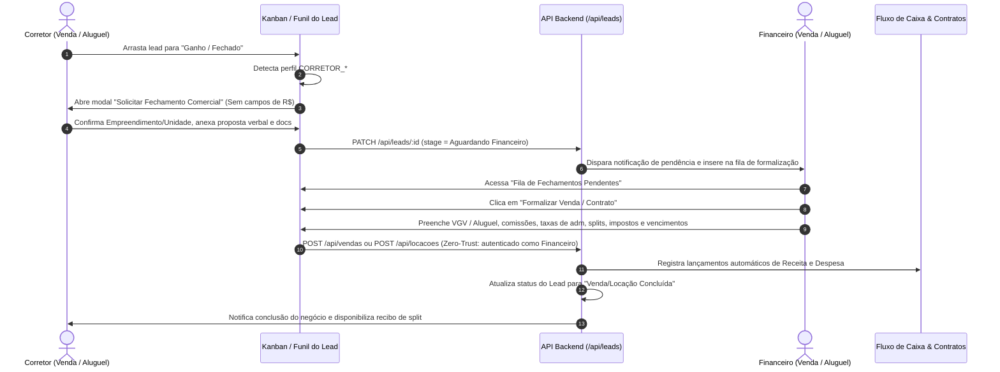

# Roadmap de Implementação: Segregação de Perfis Financeiro & Corretor (Venda vs. Aluguel)

> **Status:** Planejamento Aprovado • Aguardando Autorização para Início do Desenvolvimento  
> **Data:** 27/10/2026  
> **Projeto:** Connect Platz CRM & ERP  

---

## 1. Visão Geral e Diretrizes Consolidadas

Este documento define a especificação arquitetural e o plano passo a passo para implementar a divisão dos perfis do sistema, estabelecendo isolamento rígido entre as modalidades de **Venda** e **Aluguel**, além de retirar dos corretores qualquer responsabilidade ou permissão de lançamento financeiro.

### Decisões Alinhadas:
1. **Escopo do Aluguel (Ambos):** Contempla **Aluguel de Temporada/Veraneio** (diárias, bloqueio de calendário e taxa de limpeza) e **Locação Tradicional Anual** (contratos de 12 a 30 meses, aluguel mensal, taxa de intermediação, taxa de administração e repasse a proprietários).
2. **Migração dos Corretores Existentes:** Todos os corretores atuais da base de dados serão atribuídos ao perfil `CORRETOR_VENDA` por padrão no script de migração.
3. **Novo Fluxo de Lead Ganho:** O corretor tem permissão apenas para solicitar o fechamento comercial (confirmando unidade, comprador, observações da proposta e anexando documentos), sem qualquer input de valores monetários ou comissões. A formalização financeira, cálculo de comissões e lançamentos no ERP são exclusivos do Financeiro e Administrador.
4. **Isolamento Rígido (Zero-Trust):**
   - **Vertical:** `FINANCEIRO_VENDA` não acessa dados de Aluguel; `FINANCEIRO_ALUGUEL` não acessa dados de Venda.
   - **Horizontal:** Corretores só visualizam seus próprios leads e negócios. Não têm acesso a informações de outros corretores, mesmo que sejam da mesma modalidade.

---

## 2. Diagrama da Arquitetura de Acesso e Isolamento

```mermaid
graph TD
    subgraph Perfis de Acesso
        ADM[ADMINISTRADOR]
        FV[FINANCEIRO_VENDA]
        FA[FINANCEIRO_ALUGUEL]
        CV[CORRETOR_VENDA]
        CA[CORRETOR_ALUGUEL]
    end

    subgraph Escopo Venda
        LV[Leads de Venda]
        VND[Vendas & Comissões]
        FCV[Fluxo de Caixa - Venda]
    end

    subgraph Escopo Aluguel
        LA[Leads de Aluguel]
        ALU_TEMP[Aluguel Temporada / Bookings]
        ALU_ANUAL[Locação Tradicional Anual]
        FCA[Fluxo de Caixa - Aluguel]
    end

    ADM -->|Acesso Total Irrestrito| Escopo Venda
    ADM -->|Acesso Total Irrestrito| Escopo Aluguel

    FV -->|Acesso Total & Lançamentos| VND
    FV -->|Lançamentos ERP Venda| FCV
    FV -->|Visualiza Leads Venda| LV
    FV -.->|BLOQUEADO 403| Escopo Aluguel

    FA -->|Acesso Total & Lançamentos| ALU_TEMP
    FA -->|Acesso Total & Lançamentos| ALU_ANUAL
    FA -->|Lançamentos ERP Aluguel| FCA
    FA -->|Visualiza Leads Aluguel| LA
    FA -.->|BLOQUEADO 403| Escopo Venda

    CV -->|Apenas Seus Leads| LV
    CV -->|Solicita Fechamento SEM R$| VND
    CV -.->|BLOQUEADO 403| Escopo Aluguel
    CV -.->|BLOQUEADO 403| FCV
    CV -.->|Sem Acesso| CV_OUTRO[Outros Corretores Venda]

    CA -->|Apenas Seus Leads| LA
    CA -->|Solicita Fechamento SEM R$| ALU_ANUAL
    CA -->|Solicita Fechamento SEM R$| ALU_TEMP
    CA -.->|BLOQUEADO 403| Escopo Venda
    CA -.->|BLOQUEADO 403| FCA
    CA -.->|Sem Acesso| CA_OUTRO[Outros Corretores Aluguel]
```

---

## 3. Matriz Detalhada de Permissões (RBAC & RLS)

| Funcionalidade / Recurso | ADMINISTRADOR | FINANCEIRO_VENDA | FINANCEIRO_ALUGUEL | CORRETOR_VENDA | CORRETOR_ALUGUEL |
| :--- | :---: | :---: | :---: | :---: | :---: |
| **Vendas & Comissões (VGV, Splits, Datas)** | Leitura & Escrita | Leitura & Escrita | ❌ Bloqueado (403) | Apenas Leitura (Seus splits) | ❌ Bloqueado (403) |
| **Lançar / Alterar Valores de Venda** | ✅ Permitido | ✅ Permitido | ❌ Bloqueado | ❌ **PROIBIDO** | ❌ **PROIBIDO** |
| **Aluguel Temporada (Diárias, Limpeza)** | Leitura & Escrita | ❌ Bloqueado (403) | Leitura & Escrita | ❌ Bloqueado (403) | Apenas Leitura (Suas reservas) |
| **Locação Anual (Contratos, Aluguel Mensal)** | Leitura & Escrita | ❌ Bloqueado (403) | Leitura & Escrita | ❌ Bloqueado (403) | Apenas Leitura (Seus contratos) |
| **Lançar / Alterar Valores de Aluguel** | ✅ Permitido | ❌ Bloqueado | ✅ Permitido | ❌ **PROIBIDO** | ❌ **PROIBIDO** |
| **Fluxo de Caixa (ERP)** | Geral (Ambos) | Apenas Vendas | Apenas Aluguéis | ❌ Oculto do Menu | ❌ Oculto do Menu |
| **Leads - Venda** | Todos | Todos (Venda) | ❌ Bloqueado | **Apenas os Próprios** | ❌ Bloqueado |
| **Leads - Aluguel** | Todos | ❌ Bloqueado | Todos (Aluguel) | ❌ Bloqueado | **Apenas os Próprios** |
| **Mover Lead para "Ganho"** | ✅ Sim | ✅ Sim | ✅ Sim | ✅ Sim (Solicitação) | ✅ Sim (Solicitação) |
| **Leads de Outros Corretores** | ✅ Sim | ✅ Sim | ✅ Sim | ❌ Bloqueado (LGPD) | ❌ Bloqueado (LGPD) |
| **Gestão de Equipe (Convites/Perfis)** | Total | Leitura (Venda) | Leitura (Aluguel) | ❌ Oculto do Menu | ❌ Oculto do Menu |
| **Configurações Globais / Auditoria** | Total | ❌ Bloqueado | ❌ Bloqueado | ❌ Oculto do Menu | ❌ Oculto do Menu |

---

## 4. O Novo Fluxo: Fechamento em Duas Etapas



---

## 5. Cronograma de Implementação (Fases 1 a 6)

### Fase 1: Modelagem Relacional & Migrations (Prisma + PostgreSQL)
- **1.1 Enum `Role`:**  
  Substituição de `ADMINISTRADOR | CORRETOR` para:
  `ADMINISTRADOR`, `FINANCEIRO_VENDA`, `FINANCEIRO_ALUGUEL`, `CORRETOR_VENDA`, `CORRETOR_ALUGUEL`.
- **1.2 Entidade de Locação Tradicional (`RentalContract`):**  
  Model para locações anuais (imóvel, lead/locatário, locador/proprietário, corretor, valor aluguel, taxa adm imobiliária %, taxa intermediação, data início/fim, caução/seguro).
- **1.3 Segmentação por Modalidade:**  
  - Adicionar campo `modalidade` (`VENDA` | `ALUGUEL` | `AMBOS`) em `Funnel`, `Lead` e `CashFlow`.
  - Adicionar campo `financialApprovalStatus` (`PENDENTE`, `APROVADO`, `REJEITADO`) em `Lead`.
- **1.4 Migration e Backfill:**  
  Script SQL para converter usuários `CORRETOR` existentes em `CORRETOR_VENDA` e associar registros históricos de `CashFlow` à modalidade correspondente.
- **1.5 Atualização de Políticas RLS no PostgreSQL:**  
  Reforço das policies de Row-Level Security em `leads`, `sales`, `season_bookings`, `rental_contracts` e `cash_flows`.

---

### Fase 2: Autenticação, Sessão e Middleware
- **2.1 Sessão JWT (`lib/auth/jwt.ts` e `lib/auth/session.ts`):**  
  Tipagem estrita do payload de sessão com os novos roles.  
  Helpers semânticos: `canManageSalesValues`, `canManageRentalValues`, `isFinanceiro`, `isCorretor`, `getUserModality`.
- **2.2 Middleware de Borda (`middleware.ts`):**  
  - Rotas de Venda (`/crm/vendas`): Permitido para `ADMINISTRADOR`, `FINANCEIRO_VENDA` e leitura para `CORRETOR_VENDA`. Bloqueio 403 para perfis de Aluguel.
  - Rotas de Aluguel (`/crm/temporada`, `/crm/locacoes`): Permitido para `ADMINISTRADOR`, `FINANCEIRO_ALUGUEL` e leitura para `CORRETOR_ALUGUEL`. Bloqueio 403 para perfis de Venda.
  - Rota de Fluxo de Caixa (`/crm/fluxo-de-caixa`): Permitido para `ADMINISTRADOR` e perfis Financeiros. Bloqueio 403 para Corretores.

---

### Fase 3: Backend — Blindagem das APIs (Zero-Trust)
- **3.1 API de Vendas (`app/api/vendas/route.ts`):**  
  - `POST /api/vendas`: Rejeição imediata com `403 Forbidden` se o autor for `CORRETOR_VENDA` ou `CORRETOR_ALUGUEL`. Apenas `FINANCEIRO_VENDA` e `ADMINISTRADOR` podem criar registros de venda e definir VGV/splits.
  - `GET /api/vendas`: `FINANCEIRO_VENDA` lista todas as vendas; `CORRETOR_VENDA` lista apenas suas vendas titular/splits; perfis de Aluguel recebem `403`.
- **3.2 API de Locações / Aluguel (`app/api/bookings`, `app/api/locacoes`):**  
  - Criação de contratos e definição de valores de diárias/aluguel restrita a `FINANCEIRO_ALUGUEL` e `ADMINISTRADOR`.
- **3.3 API de Fluxo de Caixa (`app/api/financeiro/route.ts`):**  
  - Injeção obrigatória do filtro de modalidade:
    - `FINANCEIRO_VENDA` → Lançamentos com `modalidade: "VENDA"`
    - `FINANCEIRO_ALUGUEL` → Lançamentos com `modalidade: "ALUGUEL"` (Temporada e Anual)
    - `ADMINISTRADOR` → Consolidação total
- **3.4 API de Leads (`app/api/leads/route.ts` e `leadAccess.ts`):**  
  - Isolamento estrito:
    - `CORRETOR_VENDA` vê apenas leads atribuídos a si (`corretorId === session.userId`) dentro de funis de Venda.
    - `CORRETOR_ALUGUEL` vê apenas leads atribuídos a si dentro de funis de Aluguel.
    - Ocultação mútua entre corretores da mesma categoria.
- **3.5 Dashboard & BI (`app/api/dashboard`, `app/api/relatorios`):**  
  - Segregação de métricas (VGV vs. Faturamento de Locação) com base no perfil do usuário conectado.

---

### Fase 4: Frontend — Reformulação da Interface (Habitus CRM Style)
- **4.1 Sidebar Dinâmica (`components/crm/Sidebar.tsx`):**  
  - Itens de menu contextuais:
    - Usuários de Venda: visualizam *Vendas e Comissões*, itens de Aluguel ocultos.
    - Usuários de Aluguel: visualizam *Locações & Temporada*, *Vendas e Comissões* oculto.
    - Corretores: *Fluxo de Caixa*, *Equipe*, *Integrações* e *Auditoria* ocultos.
- **4.2 Modal do Corretor "Solicitar Fechamento" (`RequestClosingModal.tsx`):**  
  - Interface enxuta e elegante (máx. 300 linhas):
    - Confirmação do imóvel/unidade.
    - Dados do comprador/locatário.
    - Campo descritivo de observações da proposta verbal acordada.
    - Upload dos documentos do cliente (RG, CPF, Comprovante de Renda/Residência).
    - **Zero campos de moeda, comissão ou split financeiro.**
- **4.3 Fila de Formalização Financeira (`SalesPendingApproval.tsx` / `RentalsPendingApproval.tsx`):**  
  - Painel exclusivo do Financeiro exibindo propostas aguardando aprovação.
  - Ação: "Formalizar Negócio" (abre formulário financeiro com VGV, comissões, datas, retenções de imposto e integração ao ERP).
- **4.4 Gestão de Equipe (`components/crm/equipes/`):**  
  - Seleção dos 5 novos perfis na criação e edição de usuários.
  - Filtros e listagem segmentada por departamento (Venda vs. Aluguel).

---

### Fase 5: Integração das Regras Específicas de Locação
- **5.1 Locação Tradicional Anual:**  
  - Cadastro de contratos com vencimento mensal e reajuste anual.
  - Geração automática de contas a receber (aluguel) e contas a pagar (repasse ao proprietário deduzida a taxa de administração).
- **5.2 Aluguel de Temporada:**  
  - Manutenção do bloqueio de calendário com diárias e taxa de limpeza.
  - Integração dos recebíveis ao Fluxo de Caixa de Aluguel.

---

### Fase 6: Homologação e Atualização de Documentação
- **6.1 Atualização de Regras Permanentes (`AGENTS.md` e `GEMINI.md`):**  
  - Atualizar a seção de perfis autorizados para formalizar os 5 cargos oficiais.
- **6.2 Verificação de Tipagem Estrita:**  
  - Compilação com `npm run build` garantindo zero erros de tipos TypeScript e respeito ao limite de 350-400 linhas por arquivo.
- **6.3 Validação de Segurança (Smoke Tests):**  
  - Verificação de tentativa de lançamento de valores por corretores (retorno `403`).
  - Verificação de tentativa de acesso cruzado entre `FINANCEIRO_VENDA` e `FINANCEIRO_ALUGUEL` (retorno `403`).
  - Verificação de que corretores não conseguem ver leads de outros corretores da mesma equipe.

---

## 6. Próximo Passo

O planejamento está formalizado e registrado neste documento.  
**Nenhuma alteração de código foi iniciada.**  
A execução começará pela **Fase 1 (Prisma & Migrations)** assim que expressamente autorizado pelo usuário.
