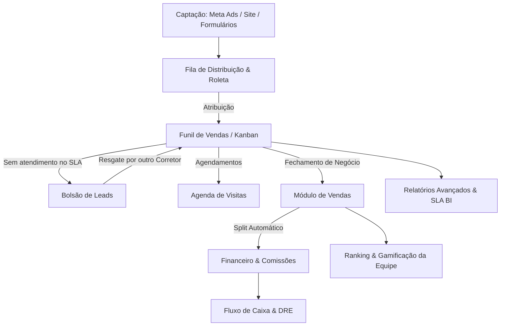

# Especificação Completa de Design, Arquitetura e Funcionalidades — Habitus CRM

> **Documento de Referência para Engenharia e Produto**  
> **Status:** Concluído e Validado  
> **Data:** Setembro/2026  
> **Origem da Análise:** Engenharia Reversa e Inspeção do Sistema Oficial [Habitus CRM](https://www.habituscrm.com.br/#funcionalidades), Vídeos Demonstrativos de Funcionalidades, Bundles de Código e Modelos de Dados.

---

## 1. Visão Geral e Diretrizes de Escopo

O objetivo deste documento é detalhar integralmente todas as telas, componentes visuais, padrões de design (UI/UX), regras de negócio e fluxos funcionais do **Habitus CRM** para replicação no nosso ecossistema.

### 📌 REGRA MANDATÓRIA DO PROJETO: FIDELIDADE VISUAL E ANIMAÇÕES
> **DIRETRIZ DE ENGENHARIA E PRODUTO (NÃO NEGOCIÁVEL):**  
> Todas as telas, layouts, micro-interações, transições e animações do sistema **devem ser estritamente inspiradas e visualmente muito parecidas com o Habitus CRM**.  
> Isso inclui:
> - **Animações de entrada suaves:** Efeitos `fadeInUp` em cards e seções, slide-in nos Drawers laterais de leads e gavetas de menu.
> - **Contadores numéricos dinâmicos (Count-Up):** Animação de subida gradual de números e valores monetários em todos os StatCards, métricas e dashboards.
> - **Kanban fluído com Drag & Drop suave:** Elevação de cards com sombras profundas (`shadow-xl`) e drop-targets bem definidos.
> - **Pódio de gamificação animado:** Coroas animadas (`AnimatedCrown`), troféus e efeitos comemorativos na tela de Ranking.
> - **Pulsos de alerta em SLAs:** Badges com timers regressivos pulsantes para leads próximos do vencimento ou atrasados.
> - **Micro-interações de botões:** Escala sutil no hover (`hover:scale-105`), sombras luminosas com a cor de destaque e transições polidas.

### ⚠️ Exclusões Explícitas Solicitadas
Conforme alinhamento:
1. **WhatsApp Integrado (NÃO INTEGRAR):** Não será implementado o cliente web WhatsApp embutido (Baileys/Meta Webhook nativo de chat inbox). No lugar dele, o sistema manterá **links e botões com deep link direto para o WhatsApp Web / App** (`https://wa.me/55...`), permitindo ao corretor abrir a conversa no aplicativo externo do WhatsApp sem acoplar a infraestrutura de mensageria ao CRM.
2. **Inteligência Artificial (IA) / Agente Laila / GPT 5.2 (NÃO INTEGRAR):** Não serão integrados agentes autônomos de IA ou LLMs externos. As classificações de leads e scores serão calculadas puramente por **regras de negócio algorítmicas determinísticas** (campos preenchidos, documentos anexados, interações realizadas, SLA de inatividade).

---

## 2. Mapeamento dos Vídeos Oficiais do Habitus CRM

Durante a análise da seção `#funcionalidades` e do changelog de versões da plataforma, foram mapeados **10 vídeos** demonstrativos em alta definição demonstrando o funcionamento real das telas:

### Vídeos da Seção `#funcionalidades` (Landing Page)
| Módulo / Funcionalidade | YouTube ID | Link do Vídeo | Thumbnail de Referência |
| :--- | :--- | :--- | :--- |
| **1. Dashboard de Gestão** | `Pa6IfHAyrmI` | [Assistir no YouTube](https://www.youtube.com/watch?v=Pa6IfHAyrmI) | `https://i.ytimg.com/vi/Pa6IfHAyrmI/hqdefault.jpg` |
| **2. Gestão de Leads & Funil** | `3iMNFbUHx3U` | [Assistir no YouTube](https://www.youtube.com/watch?v=3iMNFbUHx3U) | `https://i.ytimg.com/vi/3iMNFbUHx3U/hqdefault.jpg` |
| **3. Fluxo de Caixa e DRE** | `jRGvrPtc66w` | [Assistir no YouTube](https://www.youtube.com/watch?v=jRGvrPtc66w) | `https://i.ytimg.com/vi/jRGvrPtc66w/hqdefault.jpg` |
| **4. Vendas e Comissões** | `zwPfm-Ev1ak` | [Assistir no YouTube](https://www.youtube.com/watch?v=zwPfm-Ev1ak) | `https://i.ytimg.com/vi/zwPfm-Ev1ak/hqdefault.jpg` |
| **5. Ranking e Gestão de Equipe** | `8Y2-XVTVCSg` | [Assistir no YouTube](https://www.youtube.com/watch?v=8Y2-XVTVCSg) | `https://i.ytimg.com/vi/8Y2-XVTVCSg/hqdefault.jpg` |
| **6. Empreendimentos e Site** | `6tWozV1U2zk` | [Assistir no YouTube](https://www.youtube.com/watch?v=6tWozV1U2zk) | `https://i.ytimg.com/vi/6tWozV1U2zk/hqdefault.jpg` |
| **7. Personalização de Marca & Cores** | `yfYN1r7Y2y0` | [Assistir no YouTube](https://www.youtube.com/watch?v=yfYN1r7Y2y0) | `https://i.ytimg.com/vi/yfYN1r7Y2y0/hqdefault.jpg` |

### Vídeos de Releases & Novas Funcionalidades (Changelog do Sistema)
| Versão | Funcionalidade Principal | YouTube ID | Link do Vídeo |
| :--- | :--- | :--- | :--- |
| **v2.1.9** | **Linha do Tempo do Lead & Gravação de Voz** | `oao4mS_rjIc` | [Assistir no YouTube](https://youtu.be/oao4mS_rjIc) |
| **v2.1.5** | **Espelho de Vendas Interativo & Nova Dashboard** | `BC5mCS3bVwk` | [Assistir no YouTube](https://youtu.be/BC5mCS3bVwk) |
| **v2.1.0** | **SLA por Etapa do Funil & Contadores no Kanban** | `IwNtqj-P-9U` | [Assistir no YouTube](https://youtu.be/IwNtqj-P-9U) |
| **v2.0.8** | **Agenda do Habitus (Visitas, Follow-ups e Lembretes)**| `-eB52RWuQ_M` | [Assistir no YouTube](https://youtu.be/-eB52RWuQ_M) |

---

## 3. Design System & Identidade Visual

O design do Habitus CRM é construído sob uma estética moderna, corporativa e limpa (SaaS Dark/Light), utilizando a biblioteca **Tailwind CSS**, componentes **Radix UI / Shadcn UI**, ícones **Lucide Icons** e gráficos interativos via **Recharts**.

### 3.1 Tokens de Cores (Light & Dark Theme)

| Token | Light Mode (HSL / Hex) | Dark Mode (HSL / Hex) | Aplicação |
| :--- | :--- | :--- | :--- |
| `--primary` | `268 100% 41%` (`#5B06BD`) | `268 100% 41%` (`#5B06BD`) | Botões principais, links ativos, destaques de VGV, marca |
| `--primary-light` | `268 90% 50%` (`#7B1BF5`) | `268 90% 50%` (`#7B1BF5`) | Hover states, gradientes de destaque |
| `--primary-dark` | `268 100% 30%` (`#42048A`) | `268 100% 30%` (`#42048A`) | Headers escuros, banners promocionais |
| `--background` | `0 0% 100%` (`#FFFFFF`) | `0 0% 3.9%` (`#0A0A0A`) | Fundo geral da aplicação |
| `--card` | `0 0% 100%` (`#FFFFFF`) | `0 0% 3.9%` (`#121212`) | Cards de métricas, colunas kanban, modais |
| `--foreground` | `222 47% 11%` (`#0F172A`) | `0 0% 96%` (`#F4F4F5`) | Tipografia primária |
| `--muted` | `210 40% 96%` (`#F1F5F9`) | `0 0% 12%` (`#1F1F1F`) | Fundos secundários, linhas de tabela zebrada |
| `--muted-foreground` | `215 16% 47%` (`#64748B`) | `0 0% 80%` (`#CCCCCC`) | Legendas, rótulos, datas, hints |
| `--border` | `214 32% 91%` (`#E2E8F0`) | `240 3.7% 15.9%` (`#27272A`) | Divisórias, bordas de cards e inputs |
| `--success` | `142 71% 45%` (`#16A34A`) | `142 71% 45%` (`#16A34A`) | Vendas ganhas, pagamentos confirmados, SLA ok |
| `--destructive` | `0 84% 60%` (`#EF4444`) | `0 63% 31%` (`#7F1D1D`) | SLA vencido, exclusões, cancelamento de venda |
| `--warning / amber`| `38 92% 50%` (`#F59E0B`) | `38 92% 50%` (`#F59E0B`) | Alerta de SLA próximo do vencimento, lead morno |

### 3.2 Tipografia e Espaçamento
- **Fonte Principal:** `DM Sans`, sans-serif.
- **Hierarquia:**
  - H1: `2.25rem` a `3rem` (`font-bold`, `tracking-tight`)
  - H2: `1.5rem` a `1.875rem` (`font-semibold`)
  - H3: `1.125rem` a `1.25rem` (`font-semibold`)
  - Body: `0.875rem` (14px) e `0.75rem` (12px para badges e metadados)
- **Raios de Borda (Border Radius):**
  - Botões e inputs: `rounded-md` (`0.5rem`) ou `rounded-full` para tags/pills
  - Cards e containers: `rounded-xl` (`0.75rem`) a `rounded-2xl` (`1rem`)
  - Avatares: `rounded-full`

### 3.3 Estrutura do Layout Mestre (Shell / Layout)
1. **Sidebar Lateral (Esquerda):**
   - Logo da imobiliária (suporte a Light e Dark Mode).
   - Switcher de Filial / Loja (se houver mais de uma unidade).
   - Lista de Itens de Menu com ícones Lucide de 20px e labels claras.
   - Perfil do Usuário com avatar, nome, cargo (badge) e botão de alternância de tema (Sol/Lua).
   - Recolhimento em mobile para Menu Gaveta (Sheet deslizante à esquerda).
2. **Topbar Superior:**
   - Breadcrumb interativo com a rota atual.
   - Indicador de Notificações com badge de contagem e som configurável.
   - Seletor de Período Rápido (Hoje, 7 dias, Este Mês, Mês Passado, Ano, Customizado).
3. **Área de Conteúdo:**
   - Grid fluida com suporte a telas ultrawide, desktop, tablet e smartphones.

---

## 4. Matriz de Cargos e Permissões (RBAC)

O Habitus CRM divide o acesso em 4 papéis essenciais mais o perfil externo:

| Cargo / Nível | Escopo de Visão e Ação |
| :--- | :--- |
| **CEO / Dono** | Acesso irrestrito a todos os dados da organização, configurações de funis, regras financeiras, DRE, fluxo de caixa, comissões, exclusão de registros e integrações de API / Meta Ads. |
| **Diretor** | Visão gerencial completa de vendas, corretores, equipes, espelho de vendas e comissões. |
| **Gerente** | Visão restrita à sua própria equipe de corretores e funis vinculados à sua equipe; acesso ao bolsão compartilhado e agendamentos da sua equipe; sem acesso a configurações administrativas globais. |
| **Corretor Interno**| Visão restrita apenas aos seus próprios leads, sua agenda individual, seus imóveis cadastrados e suas próprias comissões a receber. |
| **Corretor Externo / Parceiro [UFCM]** | Cadastro simplificado de parceiro com chave PIX e e-mail; recebe comissão via split configurável e recebe o recibo de pagamento em PDF por e-mail. |

---

## 5. Especificação Funcional Módulo a Módulo



---

### Módulo 1: Dashboard de Gestão
A Dashboard é o centro de controle da operação imobiliária, apresentando métricas em tempo real e atalhos operacionais imediatos.

#### 1.1 Cards de Indicadores (KPI Cards)
- **VGV Total:** Valor Geral de Vendas acumulado no período selecionado (card em destaque com cor primária).
- **Total de Vendas:** Quantidade de contratos fechados no período.
- **Comissão Recebida:** Total de comissões que a imobiliária já recebeu das incorporadoras / proprietários.
- **Comissões Pagas & Pendentes:** Valores liquidados para corretores vs. valores a liberar.
- **Ticket Médio de Venda:** Valor médio por imóvel comercializado.
- **Leads Captados & Taxa de Conversão Geral:** Total de novos contatos vs. percentual convertido em venda ganha.
- **Corretores Ativos:** Membros da equipe com negociações em andamento.

#### 1.2 Gráficos e Componentes Visuais
1. **Evolução de Captação de Leads:** Gráfico de Linha/Área demonstrando o volume diário/semanal de entradas de leads.
2. **Regiões Mais Vendidas:** Gráfico Donut (rosca) em tons roxos e violetas agrupando as vendas por bairro/região (Zona Norte, Zona Sul, etc.).
3. **Imóveis Mais Vendidos:** Ranking horizontal em barra com os empreendimentos de maior saída.
4. **Card de Alerta de SLA:** 
   - Indicador categorizado: *Venceu Hoje*, *Vence Amanhã*, *Próximos 7 Dias*.
   - Botão de drill-down direto para a etapa do funil correspondente.
5. **Painel de Leads Quentes:** Lista com os leads de maior probabilidade de fechamento imediato (score quente), exibindo botão de ligação rápida e botão para WhatsApp Web.
6. **Linha do Tempo de Atividades Recentes:** Feed dinâmico com movimentações de etapas, novos agendamentos e registros de vendas.

---

### Módulo 2: Gestão de Leads, Múltiplos Funis & Bolsão

#### 2.1 Visualização em Funil (Kanban)
- **Múltiplos Funis de Venda:** Possibilidade de alternar entre funis (ex: *Lançamentos*, *Prontos*, *Locação*, *Minha Casa Minha Vida*).
- **Etapas Customizáveis:** Adição, renomeação e reordenação de colunas (ex: *Novo Lead*, *Primeiro Contato*, *Visita Agendada*, *Proposta Enviada*, *Em Negociação*, *Aprovado*, *Venda Ganha*, *Perdido*).
- **Drag-and-Drop:** Arrastar cards entre etapas atualizando o status instantaneamente.
- **Timer de SLA por Etapa:**
  - Configuração de prazo máximo para o lead permanecer naquela coluna (ex: 2h no primeiro contato, 48h na visita).
  - Badge colorido no card:
    - 🟢 **Verde:** No prazo.
    - 🟡 **Âmbar:** Vencimento próximo (menos de 20% do tempo restante).
    - 🔴 **Vermelho:** Estourado (com contador de atraso: "+3h de atraso").

#### 2.2 Sistema de Bolsão de Leads
- O **Bolsão** é uma área compartilhada da imobiliária onde ficam leads que:
  1. Foram cadastrados sem corretor definido;
  2. **Estouraram o tempo máximo de resposta sem interação do corretor responsável** (reversão automática de lead esquecido);
  3. Foram devolvidos voluntariamente pelo corretor.
- **Mecânica de Resgate (Takeover):** Qualquer corretor com permissão pode entrar na aba do Bolsão, visualizar os dados resumidos e clicar em **"Assumir Lead"**. Ao assumir, o lead sai do bolsão, entra no funil do corretor e dispara um timer obrigatório de primeira resposta.

#### 2.3 Visualização em Lista / Tabela
- Exibição em tabela com suporte a paginação de **200 leads por página** e até **5.000 registros**.
- Colunas: Nome, Telefone, E-mail, Origem, Empreendimento de Interesse, Corretor Responsável, Status/Etapa, Temperatura (Score), Data de Entrada, Ações Rápidas.
- Seleção em massa para reatribuição de corretor ou alteração de etapa.

#### 2.4 Ficha Detalhada do Lead (Drawer / Sheet Lateral)
Ao clicar em qualquer lead, abre-se uma gaveta lateral direita organizada em 4 abas:
1. **Aba Informações:**
   - *Dados Pessoais:* Nome completo, Telefone (com botão de clique para chamar no WhatsApp externo), E-mail, CPF, RG, Data de Nascimento, Estado Civil, Regime de Casamento, Naturalidade, Filiação (Nome da Mãe e Pai), Profissão.
   - *Perfil Financeiro:* Renda declarada, Renda informal, Faixa de investimento.
   - *Interesse Imobiliário:* Busca inteligente para associar até 3 empreendimentos/imóveis cadastrados, tipologia desejada, previsão de fechamento.
   - *Etiquetas/Tags:* Tags coloridas customizáveis (ex: *Investidor*, *Família Grande*, *Financiamento Caixa*).
2. **Aba Linha do Tempo (Timeline de Interações):**
   - Histórico cronológico de tudo o que ocorreu com o cliente.
   - **Notas de Texto:** Inserção de resumos de reuniões e follow-ups.
   - **Gravação de Áudio / Notas de Voz:** O corretor pode gravar áudios de voz falando diretamente pelo microfone do navegador para registrar o contexto da conversa sem precisar digitar.
3. **Aba Captação & Rastreamento:**
   - Origem do lead (Meta Ads, Google Ads, Formulário do Catálogo, Indicação, Portal Imobiliário).
   - Nome da Campanha, Nome do Formulário e Nome do Anúncio que geraram o lead.
4. **Aba Documentos & Anexos:**
   - Upload de arquivos categorizados por tipo:
     - Documentos de Identificação (RG, CNH, CPF) — limite até 10MB;
     - Comprovantes de Renda (Holerites, IRPF, Extrato Bancário) — limite até 30MB;
     - Comprovante de Residência;
     - Certidões de Casamento / Nascimento.
   - Pré-visualização com Lightbox para fotos e download direto de PDFs.

#### 2.5 Algoritmo de Lead Scoring (Temperatura do Lead)
Classificação puramente matemática e por regras de negócio:
- 🧊 **Lead Frio:** Poucos campos preenchidos, sem empreendimento definido, sem anexos e sem movimentação recente.
- ☕ **Lead Morno:** Contato validado, empreendimento selecionado, em fase de apresentação ou com agendamento previsto em 24h.
- 🔥 **Lead Quente:** Dados completos, documentos financeiros anexados, em etapa de Proposta ou Negociação no funil.

---

### Módulo 3: Filas e Roleta Automática de Distribuição de Leads

Para imobiliárias com equipes de corretores, os novos leads vindos de campanhas digitais não precisam de intervenção manual:
- **Criação de Filas por Campanha:** Filas específicas para *Meta Ads*, *Google Ads*, *Landing Pages* e *Portais (Chaves na Mão, Dream Casa)*.
- **Distribuição Balanceada (Roleta Ponderada):** Configuração de percentual de entrega por corretor (ex: Corretor A recebe 40%, Corretor B recebe 30%, Corretor C recebe 30%).
- **Respeito à Equipe e ao Funil:** Direcionamento direto para o funil específico daquele produto ou lançamento.
- **Temporizador de Inatividade:** Parâmetro individual de minutos máximos para o primeiro contato; se o corretor sorteado não registrar contato no tempo limite, o lead é desatribuído e movido para o bolsão.

---

### Módulo 4: Agenda do Corretor e Visitas

Substitui completamente o uso de agendas de papel ou planilhas:
- **Visões do Calendário:** Visualização por **Dia**, **Semana** e **Mês**.
- **Tipos de Eventos com Identificação por Cor:**
  - 🏠 *Visita ao Imóvel*
  - 🔄 *Retorno / Follow-up*
  - 👥 *Reunião Presencial / Online*
  - 📞 *Ligação / Contato Telefônico*
  - 📝 *Apresentação de Proposta*
  - 🔍 *Vistoria de Imóvel*
  - 📑 *Assinatura de Documentação*
  - 🔑 *Entrega de Chaves*
  - 🏢 *Plantão de Vendas*
  - 🎓 *Treinamento Interno*
  - ⏰ *Lembrete Geral*
- **Vínculo com Entidades:** Cada compromisso pode ser vinculado a um **Lead** existente e a um **Empreendimento**, preenchendo automaticamente o endereço no card do compromisso.
- **Status do Evento:** *Agendado*, *Concluído*, *Cancelado* e *Não Compareceu* (com registro de motivo).

---

### Módulo 5: Vendas, Contratos e Split de Comissões

Módulo que resolve o maior atrito financeiro de imobiliárias: a divisão e transparência de comissões.

#### 5.1 Cadastro de Venda
- Vinculação com o Lead cadastrado, Empreendimento e Unidade vendida.
- Valor total da transação e percentual negociado de comissão total.
- Upload do contrato de compra e venda assinado e comprovantes de sinal.

#### 5.2 Split Automático de Comissões
O sistema calcula automaticamente as fatias da comissão com base nas regras configuradas:
1. **Fatia da Imobiliária (Receita Líquida da Empresa)**
2. **Comissão do Diretor**
3. **Comissão do Gerente de Equipe**
4. **Comissão do Corretor Titular**
5. **Comissão de Parceria (Corretor 2 / Co-corretor)**
6. **Comissão de Captação (quem captou o imóvel)**
7. **Corretores Externos / Imobiliárias Parceiras [UFCM]**
8. **Premiação / Cashback:** Valor fixo ou percentual promocional.

#### 5.3 Parcelamento e Baixa Financeira
- Suporte a vendas à vista (1x) ou comissionamento parcelado em etapas (conforme a construtora paga).
- Controle de status por parcela: *Pendente*, *Parcialmente Paga*, *Paga*.
- **Emissão de Recibos em PDF:** Geração com 1 clique do documento de quitação de comissão com layout profissional timbrado e envio automático por e-mail para parceiros externos.

---

### Módulo 6: Fluxo de Caixa, Contas a Pagar/Receber & DRE Gerencial

Módulo reservado a diretores e CEOs (`managerOnly: true`):

#### 6.1 Contas a Pagar e Contas a Receber
- Registro de despesas com categorias pré-definidas: *Água, Luz, Internet, Salários, Comissões, Aluguel de Sede, Material de Escritório, Tráfego Pago/Meta Ads, Manutenção, Impostos*.
- Registro de receitas: *Comissões de Terceiros, Comissões de Lançamento, Honorários de Consultoria, Taxas Administrativas*.
- **Recorrências:** Configuração de despesas fixas mensais automáticas.
- Anexo de notas fiscais e comprovantes bancários com pré-visualização.

#### 6.2 DRE Gerencial em Tempo Real
Estrutura contábil automática calculada pelo sistema:
1. **(+) Receita Operacional Bruta (Comissões totais faturadas)**
2. **(-) Deduções da Receita e Impostos**
3. **(=) Receita Operacional Líquida**
4. **(-) Custos Variáveis (Split de comissões pagas aos corretores/parceiros)**
5. **(=) Margem de Contribuição / Lucro Bruto**
6. **(-) Despesas Operacionais (Administrativas, Marketing, Fixas)**
7. **(=) EBITDA / Resultado Operacional**
8. **(=) Lucro Líquido do Exercício**

#### 6.3 Projeção de Saldo de Caixa
Gráfico projetando os recebimentos e despesas futuras para os próximos 30, 60 e 90 dias, evitando surpresas de fluxo de caixa.

---

### Módulo 7: Empreendimentos, Unidades & Espelho de Vendas

#### 7.1 Cadastro Completo do Imóvel / Empreendimento
- **Informações Gerais:** Nome, Construtora/Incorporadora, Estágio da Obra (*Lançamento*, *Em Obras*, *Pronto para Morar*), Previsão de Entrega.
- **Localização:** CEP com autopreenchimento (ViaCEP / BrasilAPI), Bairro, Cidade, Estado, Região (Zona Sul, Norte, etc.) e integração de mapa.
- **Galeria de Mídia:** Upload de até **25 fotos em alta resolução** com reordenação por arrasto, suporte a plantas baixas e incorporação de tours virtuais ou vídeos do YouTube.
- **Características Detalhadas:** Quartos, suítes, banheiros, vagas de garagem, área privativa ($m^2$), área total, posição solar, taxa de condomínio e IPTU.
- **Áreas Comuns / Diferenciais:** Checkboxes com ícones (Piscina, Academia, Salão de Festas, Coworking, Portaria 24h, Pet Place, Energia Solar, etc.).

#### 7.2 Espelho de Vendas Interativo
- Estruturação visual de Torres/Blocos e Pavimentos/Andares.
- **Cadastro em Lote de Unidades:** Ferramenta para criar rapidamente dezenas de unidades usando padrão de intervalo (ex: `101-108`) ou lista nominal.
- **Grid de Unidades Colorida:**
  - 🟩 **Disponível:** Verde / Emerald (exibe valor e metragem).
  - 🟨 **Reservada:** Amarelo / Amber (com nome do corretor e prazo da reserva).
  - 🟥 **Vendida:** Vermelho (bloqueada para novas propostas).
  - ⬜ **Bloqueada:** Cinza / Muted (unidade da diretoria/permutante).
- **Espelho Público de Vendas:** Link externo (`/empreendimentos/:orgSlug/:empreendimentoSlug/espelho`) que pode ser compartilhado com clientes ou corretores externos em tempo real sem expor dados internos do CRM.

---

### Módulo 8: Catálogo Digital Público & Site da Imobiliária

O Habitus CRM gera automaticamente uma vitrine digital pública para a imobiliária:
- **10 Templates Visuais:** Seleção de layout modernos e responsivos.
- **Configuração de Marca:** Inclusão de Logomarca, CRECI, telefone e dados de contato.
- **SEO & Redes Sociais:** Meta tags OpenGraph customizadas para que, ao compartilhar o link no WhatsApp ou redes sociais, apareça a imagem do imóvel, título e valor formatados.
- **Captura Integrada:** Todo lead que preencher o formulário no site do imóvel cai instantaneamente no funil de vendas correspondente dentro do CRM.

---

### Módulo 9: Ranking, Metas & Gamificação

Módulo focado em motivar a equipe comercial:
- **Pódio Visual:** Destaque para 1º, 2º e 3º Lugar com coroas animadas (`AnimatedCrown`), troféus e medalhas.
- **Critérios de Ordenação do Ranking:**
  - Por VGV Vendido (R$)
  - Por Número de Vendas
  - Por Ticket Médio
  - Por Taxa de Conversão
- **Filtros de Ranking:** Ranking de Corretores, Ranking de Gerentes, Ranking de Equipes e Ranking de Lojas/Filiais.
- **Badges de Reconhecimento:**
  - 👑 *Corretor do Mês*
  - 🏆 *Gerente do Mês*
  - 🚀 *Mais Visitas Realizadas*
  - 🎯 *Melhor Taxa de Conversão*
  - 📋 *Mais Captações Ativas*
- **Gestão de Metas:** Metas individuais e coletivas mensais com barra de progresso visual ("Faltam R$ 150.000 para a meta"). Disparo de notificação sonora e visual quando a meta é superada.

---

### Módulo 10: Relatórios Avançados (BI) & Indicadores de SLA

Relatórios analíticos para tomada de decisão:
1. **Relatório de Volume e Funil:** Entradas no período, leads ativos, leads no bolsão, taxa de resgate, conversão inter-etapas.
2. **Relatório de Eficiência do Funil:** Tempo médio (em horas/dias) que um cliente leva para avançar de cada etapa para a próxima.
3. **Relatório de Aderência ao SLA:** Índice de cumprimento de prazos da equipe, atraso médio em minutos e etapas com maior taxa de gargalo.
4. **Relatório de Origem e ROI de Campanhas:** Quantidade de vendas e VGV gerados por canal (Meta Ads vs. Google Ads vs. Indicações).
5. **Exportação:** Exportação dos dados para relatórios em **PDF** formatado ou planilhas **Excel (.xlsx)** via biblioteca nativa.

---

### Módulo 11: Gestão de Equipe & Hierarquia Organizacional
- Criação e gestão de equipes de vendas vinculadas a um Gerente responsável.
- Isolamento de visibilidade: corretores e gerentes só enxergam informações da sua respectiva equipe, preservando a concorrência saudável e a segurança de dados.
- Link de convite rápido por e-mail para cadastrar novos corretores.

---

### Módulo 12: Administração e Customização White-Label
- **Identidade da Imobiliária:** Nome fantasia, Razão Social, CNPJ, CRECI, upload de Logomarca (com ajuste automático de contraste para tema claro e escuro) e Favicon.
- **Configurador de Funis:** Criação de novos funis de vendas, adição de etapas personalizadas e definição de regras de SLA por etapa.
- **Configurador do Bolsão:** Ativação/Desativação da funcionalidade e ajuste do tempo de tolerância para expiração de leads.
- **Formulários Externos de Captura:** Gerador de links públicos de formulário (`/f/:orgSlug/:formSlug`) para captar dados personalizados de clientes com integração direta às colunas do funil.

---

## 6. Arquitetura do Modelo de Dados (Supabase / PostgreSQL)

Abaixo está o esquema das principais entidades do banco de dados utilizadas pelo sistema:

```sql
-- Organizações (Imobiliárias)
CREATE TABLE organizations (
    id UUID PRIMARY KEY DEFAULT gen_random_uuid(),
    nome TEXT NOT NULL,
    slug TEXT UNIQUE NOT NULL,
    cnpj TEXT,
    creci TEXT,
    logo_url TEXT,
    logo_dark_url TEXT,
    primary_color TEXT DEFAULT '#5B06BD',
    bolsao_enabled BOOLEAN DEFAULT true,
    created_at TIMESTAMP WITH TIME ZONE DEFAULT timezone('utc'::text, now())
);

-- Perfis de Usuários
CREATE TABLE profiles (
    id UUID PRIMARY KEY REFERENCES auth.users(id),
    organization_id UUID REFERENCES organizations(id),
    nome TEXT NOT NULL,
    email TEXT NOT NULL,
    telefone TEXT,
    photo_url TEXT,
    is_active BOOLEAN DEFAULT true,
    created_at TIMESTAMP WITH TIME ZONE DEFAULT now()
);

-- Funis de Vendas e Etapas
CREATE TABLE funnels (
    id UUID PRIMARY KEY DEFAULT gen_random_uuid(),
    organization_id UUID REFERENCES organizations(id),
    nome TEXT NOT NULL,
    is_active BOOLEAN DEFAULT true,
    created_at TIMESTAMP WITH TIME ZONE DEFAULT now()
);

CREATE TABLE funnel_stages (
    id UUID PRIMARY KEY DEFAULT gen_random_uuid(),
    funnel_id UUID REFERENCES funnels(id) ON DELETE CASCADE,
    nome TEXT NOT NULL,
    posicao INTEGER NOT NULL,
    cor TEXT DEFAULT '#64748B',
    sla_minutes INTEGER, -- Prazo em minutos antes de estourar
    action_on_expire TEXT DEFAULT 'bolsao', -- 'bolsao' ou 'notify'
    created_at TIMESTAMP WITH TIME ZONE DEFAULT now()
);

-- Leads
CREATE TABLE leads (
    id UUID PRIMARY KEY DEFAULT gen_random_uuid(),
    organization_id UUID REFERENCES organizations(id),
    funnel_id UUID REFERENCES funnels(id),
    stage_id UUID REFERENCES funnel_stages(id),
    corretor_id UUID REFERENCES profiles(id),
    nome TEXT NOT NULL,
    telefone TEXT NOT NULL,
    email TEXT,
    cpf TEXT,
    rg TEXT,
    data_nascimento DATE,
    estado_civil TEXT,
    regime_casamento TEXT,
    profissao TEXT,
    renda_declarada NUMERIC(12,2),
    renda_informal NUMERIC(12,2),
    temperatura TEXT DEFAULT 'frio', -- 'frio', 'morno', 'quente'
    is_bolsao BOOLEAN DEFAULT false,
    bolsao_timer_started_at TIMESTAMP WITH TIME ZONE,
    is_bolsao_timer_active BOOLEAN DEFAULT false,
    origem_id TEXT,
    formulario_nome TEXT,
    campanha_nome TEXT,
    anuncio_nome TEXT,
    created_at TIMESTAMP WITH TIME ZONE DEFAULT now()
);

-- Linha do Tempo do Lead (Histórico e Voz)
CREATE TABLE lead_timeline (
    id UUID PRIMARY KEY DEFAULT gen_random_uuid(),
    lead_id UUID REFERENCES leads(id) ON DELETE CASCADE,
    user_id UUID REFERENCES profiles(id),
    tipo TEXT NOT NULL, -- 'nota', 'audio', 'status_change', 'visita'
    conteudo TEXT,
    audio_url TEXT,
    duracao_segundos INTEGER,
    created_at TIMESTAMP WITH TIME ZONE DEFAULT now()
);

-- Empreendimentos e Imóveis
CREATE TABLE empreendimentos (
    id UUID PRIMARY KEY DEFAULT gen_random_uuid(),
    organization_id UUID REFERENCES organizations(id),
    nome TEXT NOT NULL,
    slug TEXT NOT NULL,
    tipo TEXT, -- 'apartamento', 'casa', 'lote', 'comercial'
    estagio_obra TEXT, -- 'lancamento', 'em_obras', 'pronto'
    valor_a_partir NUMERIC(14,2),
    endereco TEXT,
    bairro TEXT,
    cidade TEXT,
    estado TEXT,
    zona TEXT,
    descricao TEXT,
    fotos TEXT[], -- Array de URLs (até 25 fotos)
    video_url TEXT,
    caracteristicas JSONB, -- quartos, banheiros, vagas, area_m2
    diferenciais TEXT[],
    created_at TIMESTAMP WITH TIME ZONE DEFAULT now()
);

-- Unidades do Empreendimento (Espelho de Vendas)
CREATE TABLE empreendimento_unidades (
    id UUID PRIMARY KEY DEFAULT gen_random_uuid(),
    empreendimento_id UUID REFERENCES empreendimentos(id) ON DELETE CASCADE,
    bloco TEXT NOT NULL,
    pavimento TEXT,
    numero_unidade TEXT NOT NULL,
    status TEXT DEFAULT 'disponivel', -- 'disponivel', 'reservada', 'vendida', 'bloqueada'
    valor NUMERIC(14,2),
    area_privativa NUMERIC(8,2),
    reservado_para_corretor_id UUID REFERENCES profiles(id),
    reserva_expira_em TIMESTAMP WITH TIME ZONE,
    created_at TIMESTAMP WITH TIME ZONE DEFAULT now()
);

-- Vendas e Contratos
CREATE TABLE vendas (
    id UUID PRIMARY KEY DEFAULT gen_random_uuid(),
    organization_id UUID REFERENCES organizations(id),
    codigo_venda TEXT,
    lead_id UUID REFERENCES leads(id),
    empreendimento_id UUID REFERENCES empreendimentos(id),
    unidade_id UUID REFERENCES empreendimento_unidades(id),
    corretor_id UUID REFERENCES profiles(id),
    valor_venda NUMERIC(14,2) NOT NULL,
    valor_comissao_total NUMERIC(14,2) NOT NULL,
    status TEXT DEFAULT 'ativa', -- 'ativa', 'cancelada'
    status_comissao TEXT DEFAULT 'pendente', -- 'pendente', 'parcial', 'paga'
    data_venda DATE NOT NULL,
    created_at TIMESTAMP WITH TIME ZONE DEFAULT now()
);

-- Parcelas de Comissões e Split
CREATE TABLE comissoes_parcelas (
    id UUID PRIMARY KEY DEFAULT gen_random_uuid(),
    venda_id UUID REFERENCES vendas(id) ON DELETE CASCADE,
    beneficiario_tipo TEXT NOT NULL, -- 'imobiliaria', 'diretor', 'gerente', 'corretor_1', 'corretor_2', 'externo'
    beneficiario_id UUID, -- ID de profile ou corretor externo
    parcela_numero INTEGER NOT NULL,
    valor NUMERIC(12,2) NOT NULL,
    data_vencimento DATE NOT NULL,
    status TEXT DEFAULT 'pendente', -- 'pendente', 'pago'
    data_pagamento DATE,
    comprovante_url TEXT,
    created_at TIMESTAMP WITH TIME ZONE DEFAULT now()
);

-- Agenda de Compromissos
CREATE TABLE agenda_eventos (
    id UUID PRIMARY KEY DEFAULT gen_random_uuid(),
    organization_id UUID REFERENCES organizations(id),
    user_id UUID REFERENCES profiles(id),
    lead_id UUID REFERENCES leads(id),
    empreendimento_id UUID REFERENCES empreendimentos(id),
    tipo TEXT NOT NULL, -- 'visita', 'retorno', 'reuniao', 'ligacao', etc.
    titulo TEXT NOT NULL,
    data_inicio TIMESTAMP WITH TIME ZONE NOT NULL,
    data_fim TIMESTAMP WITH TIME ZONE NOT NULL,
    status TEXT DEFAULT 'agendado', -- 'agendado', 'concluido', 'cancelado', 'nao_compareceu'
    visit_result TEXT,
    observacoes TEXT,
    created_at TIMESTAMP WITH TIME ZONE DEFAULT now()
);

-- Contas Financeiras (Fluxo de Caixa)
CREATE TABLE fluxo_contas (
    id UUID PRIMARY KEY DEFAULT gen_random_uuid(),
    organization_id UUID REFERENCES organizations(id),
    tipo TEXT NOT NULL, -- 'despesa', 'receita'
    categoria TEXT NOT NULL,
    descricao TEXT NOT NULL,
    valor NUMERIC(14,2) NOT NULL,
    data_vencimento DATE NOT NULL,
    status TEXT DEFAULT 'pendente', -- 'pendente', 'pago'
    data_pagamento DATE,
    forma_pagamento TEXT,
    conta_bancaria TEXT,
    is_recorrente BOOLEAN DEFAULT false,
    anexo_url TEXT,
    created_at TIMESTAMP WITH TIME ZONE DEFAULT now()
);
```

---

## 7. Roteiro de Telas para Implementação

| Tela / Rota | Nome do Módulo | Componentes Principais |
| :--- | :--- | :--- |
| `/` | **Dashboard Executiva** | StatCards (VGV, Vendas, Ticket Médio), Gráficos (Evolução de Leads, Rosca de Regiões, Barras de Imóveis), Card SLA, Leads Quentes |
| `/leads` | **Gestão de Leads & Funil** | Seletor de Funis, Visualização Kanban com contadores SLA, Visualização Lista com paginação até 5000 leads, Botão Bolsão, UnifiedFilterSheet |
| `/leads (Sheet)` | **Ficha do Lead (Drawer Lateral)** | Abas: Dados Pessoais/PF, Linha do Tempo com Gravação de Áudio, Captação & Rastreamento de Campanha, Anexos categorizados com Lightbox |
| `/agenda` | **Agenda Imobiliária** | Grade Dia/Semana/Mês, 11 tipos com badges coloridos, Modal de criação vinculado ao Lead e Imóvel, Desfecho de Visitas |
| `/financeiro` | **Vendas & Comissões** | Listagem de Vendas, Split de Comissão em tempo real, Parcelamento, Baixa de comissões, Gerador de Recibo em PDF |
| `/fluxo-de-caixa` | **Fluxo de Caixa & DRE** | Contas a Pagar/Receber, Calendário de vencimentos, Tabela de DRE Gerencial automático, Projeção de Caixa |
| `/empreendimentos` | **Catálogo de Imóveis** | Grid de Empreendimentos, Galeria de até 25 fotos com Lightbox, Painel de Espelho de Vendas interativo por blocos |
| `/ranking` | **Ranking & Gamificação** | Pódio animado com coroas (1º, 2º e 3º), Ranking de Corretores/Gerentes/Equipes, Badges de destaque, Metas com barra de progresso |
| `/relatorios-avancados` | **BI & Indicadores SLA** | Métricas de volume, funil inter-etapas, tempo médio em horas por etapa, atraso de SLA, exportação Excel/PDF |
| `/equipe` | **Gestão de Equipes** | Hierarquia Organizacional, Construtor de Equipes, Associação de Gerentes, Restrição de escopo de dados |
| `/administracao` | **Configurações Gerais** | Gestão de Múltiplos Funis, Configuração de SLAs por etapa, Configuração do Bolsão, Personalização de Marca |
| `/empreendimentos/:orgSlug` | **Site Público / Catálogo** | 10 templates públicos para clientes, links diretos de WhatsApp, cards de imóveis responsivos com metatags OG |
| `/espelho (Público)` | **Espelho de Vendas Público** | Grid interativo de unidades em tempo real para incorporadoras, corretores externos e compradores |

---

## 8. Considerações Finais de Entrega
Todas as regras de negócio, layouts e componentes documentados foram extraídos diretamente da versão em produção do Habitus CRM (v2.2.5). A especificação respeita estritamente a solicitação do usuário, **suprimindo os módulos de inteligência artificial autônoma e de integração web direta de WhatsApp**, mantendo toda a robustez de funis, SLAs, bolsão, comissões, fluxo de caixa, espelho de vendas e gamificação comercial.
