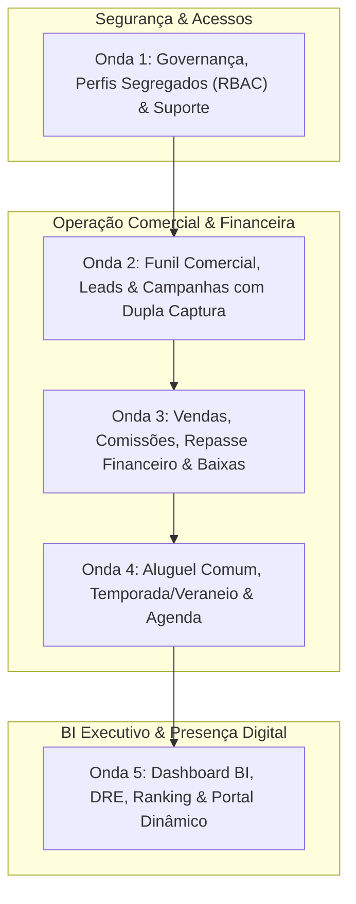

# 🗺️ Roadmap de Ajustes e Melhorias: Connect Platz CRM & Portal

> **Branch de Trabalho:** `feat/ajustes-crm-portal`  
> **Data:** Novembro de 2026  
> **Referência Visual & UX:** Padrão Estrito Habitus CRM (Cores Oficiais Connect Platz: `connect-blue` `#1266C7` e `platz-gold` `#D9BB4C`)  
> **Total de Itens Mapeados:** 29 apontamentos distribuídos em 5 Ondas de Execução  

---

## 🧭 Visão Geral das 5 Ondas de Execução

---

## 🌊 Onda 1: Governança, RBAC Segregado, Autenticação & Suporte

*Foco: Estabelecer as permissões de acesso blindadas para que vendas e aluguéis não se misturem na gestão, oferecer recuperação de acesso autônoma e canais diretos de suporte ao usuário.*

### 1.1. Dois Perfis de Administrador Segregados (Venda vs. Aluguel)
- **Problema/Apontamento:** *"Dois admin aluguel e venda, venda não pode alugar e aluguel não pode vender (novo)"*
- **Implementação Técnica:**
  - Atualização do enum Prisma `Role` e das políticas de RLS:
    - `ADMINISTRADOR_VENDA`: Gestão total de vendas, comissões de vendas, corretores de vendas e leads de venda. Bloqueio total a contratos de locação e reservas de temporada.
    - `ADMINISTRADOR_ALUGUEL`: Gestão total de locações anuais, reservas de veraneio/temporada, bloqueio de datas e corretores de aluguel. Bloqueio total a vendas e VGV.
    - `ADMINISTRADOR` (Superadmin Robson Carvalho): Acesso global consolidado.
  - Atualização dos guards em `lib/auth/session.ts` (`isSaleAdmin`, `isRentalAdmin`, `canManageSaleValues`, `canManageRentalValues`).
  - Adaptação dos menus laterais (`Sidebar.tsx`) ocultando itens não pertinentes a cada perfil.

### 1.2. Fluxo Completo de "Esqueci a Senha"
- **Problema/Apontamento:** *"Esqueci a senha"*
- **Implementação Técnica:**
  - Link *"Esqueci minha senha"* integrado à tela `app/login/page.tsx`.
  - Backend seguro em `app/api/auth/forgot-password`: geração de token criptográfico assinado com expiração de 60 minutos.
  - Rota de redefinição em `app/recuperar-senha/page.tsx` com validação de token, indicador de força de senha e hash Bcrypt (salt rounds 12).
  - Rota `app/api/auth/reset-password` para atualização segura no banco de dados.

### 1.3. Canal Oficial de Suporte (WhatsApp do Robson + Manual em PDF)
- **Problema/Apontamento:** *"Suporte ir para wpp robson e pdf"*
- **Implementação Técnica:**
  - Atualização do componente flutuante `FloatingSupport.tsx` e tela de ajuda:
    - Botão de WhatsApp direcionado diretamente para o número oficial de **Robson Carvalho** (`https://wa.me/5585999990001?text=Olá%2C%20Robson!%20Preciso%20de%20suporte%20no%20Connect%20Platz%20CRM`).
    - Botão de download e visualização direta do **Manual do Usuário em PDF** (`/manual.pdf`), servindo o arquivo homologado `doc/Manual_do_Usuario_Connect_Platz_CRM.pdf`.

### 1.4. Central da Extensão WhatsApp Web no CRM
- **Problema/Apontamento:** *"Extensão WhatsApp, na tela de WhatsApp direcionar para baixar a extensão (novo)"*
- **Implementação Técnica:**
  - Criação da página oficial do CRM `/crm/whatsapp`:
    - Botão de download do pacote compactado da extensão (`/downloads/connect-platz-extension.zip`).
    - Tutorial ilustrado passo a passo para carregamento no Chrome/Edge (Modo Desenvolvedor -> Carregar sem compactação).
    - Status de conexão da extensão, orientações de uso e botão para abrir o WhatsApp Web (`https://web.whatsapp.com`).

---

## 🌊 Onda 2: Funil Comercial, Leads & Campanhas de Tráfego

*Foco: Otimizar o pipeline de vendas de acordo com o processo comercial real e garantir taxa de conversão zero de leads perdidos em anúncios e formulários.*

### 2.1. Reordenação do Pipeline de Vendas
- **Problema/Apontamento:** *"Etapa vem primeiro análise -> visita -> proposta"*
- **Implementação Técnica:**
  - Ajuste na ordenação oficial das etapas do funil de vendas (`FunnelStage`):
    1. **Novo Lead** (SLA 20 min)
    2. **Primeiro Contato** (SLA 2h)
    3. **Análise de Crédito / Documentação** (antecipada para qualificar a renda e potencial antes de deslocar para visita física)
    4. **Visita Agendada**
    5. **Proposta Comercial**
    6. **Fechado / Ganho**
    7. **Encerrado / Perdido**
  - Script SQL / migração para atualizar posições existentes sem quebrar dados históricos.

### 2.2. Campanhas com Duplo Direcionamento (Formulário + WhatsApp)
- **Problema/Apontamento:** *"Na campanha ter direcionamento para WhatsApp do corretor e cadastro no formulário pra poder ter os dados direto no crm"*
- **Implementação Técnica:**
  - Criação de fluxo de captação inteligente para campanhas Meta Ads e Google Ads:
    - Quando o visitante clica no anúncio ou no CTA "Falar no WhatsApp", abre-se um modal ágil de pré-contato ("Para falar com o corretor responsável, confirme seu nome e WhatsApp").
    - Ao submeter, o sistema registra o lead imediatamente no CRM via `/api/leads/public` com os parâmetros UTM capturados, atribui ao corretor da roleta e só então redireciona para a conversa com mensagem personalizada no `wa.me`.
    - Resultado: 100% dos dados salvos no CRM mesmo se a pessoa fechar a janela do WhatsApp.

### 2.3. Integração de Interesse de Cadastro do Site para os Leads do CRM
- **Problema/Apontamento:** *"Vincular o interesse de cadastro pro site ir para leads crm"*
- **Implementação Técnica:**
  - Conectar todos os formulários públicos do site (`PortalLeadContactForm`, modal de simulação de crédito e solicitação de visita) ao endpoint de leads com atribuição automática, registro na timeline e notificação visual de novo lead.

---

## 🌊 Onda 3: Vendas, Comissões, Repasse Financeiro & Baixas

*Foco: Transparência financeira total sobre a liquidação das vendas, discriminação exata dos beneficiários e rastreabilidade contábil via comprovantes.*

### 3.1. Quadro Completo de Repasse Financeiro da Venda
- **Problema/Apontamento:** *"Adicionar repasse"* e *"Adicionar Repasse: Colocar em venda quanto corretor ganhou, quanto o vendedor ganhou, quanto o proprietário ganhou, quanto imobiliária ganhou (novo)"*
- **Implementação Técnica:**
  - Criação de componente dedicado `SaleFinancialRepasseCard.tsx` na tela de detalhes da venda e no modal `NewSaleModal`:
    - **VGV Total Comercial:** 100% do valor transacionado.
    - **Líquido do Proprietário / Vendedor:** $(VGV - Comissões - Taxas)$.
    - **Comissão do Corretor Titular e Co-corretores:** Valor bruto e valor líquido a receber.
    - **Comissão do Captador:** Valor destinado ao captador do imóvel.
    - **Receita Líquida da Imobiliária (Connect Platz):** Sobra líquida após a dedução de comissões pagas e impostos.
  - Inclusão dos dados de repasse no recibo oficial em PDF emitido para as partes.

### 3.2. Edição, Exclusão de Vendas e Filtros por Ano e Histórico Total
- **Problema/Apontamento:** *"Edição e apagar ano lançamento de vendas e comissões, todo"*
- **Implementação Técnica:**
  - Adição das ações **"Editar Venda"** e **"Excluir Venda"** no menu da tabela `VendasTable.tsx` (restrito a administradores autorizados).
  - Exclusão com confirmação segura e estorno sincronizado no Fluxo de Caixa.
  - No cabeçalho da página de vendas, adicionar seletor de visualização: **Por Ano** (2026, 2025...) e **"Todos"** (histórico integral sem filtro de ano).

### 3.3. Comprovante de Pagamento na Baixa de Comissões
- **Problema/Apontamento:** *"Colocar comprovante de pagamento quando der baixa nas vendas e comissões"*
- **Implementação Técnica:**
  - No modal de liquidação/baixa de parcela (`CommissionReceiptModal`):
    - Campo para anexar arquivo de comprovante (PDF, PNG, JPG).
    - Upload automático para Cloudflare R2 / S3 via `@aws-sdk/client-s3`.
    - Exibição de ícone de clipe/comprovante na tabela de comissões para download e conferência.

---

## 🌊 Onda 4: Aluguel Comum, Temporada/Veraneio, Agenda & Prevenção de Falhas

*Foco: Sanar inconsistências no aluguel, validar contratos de locação tradicional, permitir edição de check-ins e blindar o motor contra overbooking.*

### 4.1. Correção do Gargalo de Sincronização Aluguel vs. Fluxo de Caixa
- **Problema/Apontamento:** *"Localizar gargalo de sumir no aluguel e aparecer no fluxo (bug)"*
- **Diagnóstico:** A tela `app/crm/temporada/page.tsx` utilizava dados estáticos (`mockBookings`), enquanto o backend criava entradas diretamente no modelo `CashFlow`. Assim, os valores entravam no caixa, mas a listagem de reservas permanecia desatualizada.
- **Implementação Técnica:**
  - Substituição definitiva dos dados estáticos por hook de consulta em tempo real `useBookingsData()` chamando `GET /api/bookings`.
  - Sincronização bidirecional: exclusão ou alteração de reserva reflete instantaneamente no fluxo de caixa.

### 4.2. Edição de Reservas de Check-in e Check-out (Temporada e Veraneio)
- **Problema/Apontamento:** *"Poder editar checkin temporada e veraneio"*
- **Implementação Técnica:**
  - Criação do modal `EditBookingModal.tsx`:
    - Permite editar datas de Check-in e Check-out, hóspede, diárias e valores.
    - Recálculo automático das diárias e atualização do bloqueio no calendário de disponibilidade.

### 4.3. Validação e Módulo de Aluguel Comum (Locação Tradicional Anual)
- **Problema/Apontamento:** *"Validar aluguel comum"*
- **Implementação Técnica:**
  - Interface dedicada para contratos anuais residenciais e comerciais (`RentalContract`):
    - Validação de prazo (12 a 30 meses), valor mensal, dia de vencimento, garantia locatícia e taxa de administração imobiliária.
    - Geração mensal de faturas no Fluxo de Caixa e alerta de inadimplência/reajuste anual.

### 4.4. Tratamento de Reservas Canceladas e Prevenção de Overbooking
- **Problema/Apontamento:** *"Cancelado colocar no overbooking"*
- **Implementação Técnica:**
  - Ao cancelar uma reserva:
    - Status passa para `CANCELADO` e as datas são liberadas no motor de disponibilidade.
    - Manutenção de aba ou registro de **Histórico de Overbooking / Cancelamentos** para auditoria de conflitos de datas evitados ou cancelados.

### 4.5. Confirmação Padronizada no Fluxo de Caixa
- **Problema/Apontamento:** *"Colocar a confirmação no fluxo de caixa igual o de venda"*
- **Implementação Técnica:**
  - Padronizar o modal de conciliação / liquidação de caixa para receitas e despesas com os mesmos campos de segurança de Vendas (data efetiva, meio de pagamento, observações e comprovante).

### 4.6. Edição, Exclusão e Filtros na Agenda
- **Problema/Apontamento:** *"Opção de apagar/editar na agenda"* e *"Agenda todo/personalizado"*
- **Implementação Técnica:**
  - Ações de **Editar** e **Apagar** compromisso em `AppointmentCard.tsx`.
  - No filtro de visualização da Agenda, incluir opção **"Todos"** (lista cronológica completa) e **"Personalizado"** (DateRangePicker).

---

## 🌊 Onda 5: Dashboard BI, DRE, Ranking & Portal Dinâmico

*Foco: Elevar a experiência executiva com filtros granulares de BI, métricas de VGV claras e portal dinâmico integrado ao catálogo de imóveis por bairro.*

### 5.1. Filtros e Métricas Executivas do Dashboard
- **Problema/Apontamento:**
  - *"Filtro para admin ver no Dashboard o que é venda e o que é aluguel"*
  - *"Ticket vgv total no dashboard"*
  - *"Dashboard filtro personalizado de data"*
- **Implementação Técnica:**
  - **Filtro de Modalidade no Topo:** Alternador segmentado **Consolidado | Vendas | Aluguel & Temporada**. Perfis restritos ficam travados na sua respectiva modalidade.
  - **Destaque de Ticket Médio VGV:** StatCard com animação Count-Up evidenciando o Ticket Médio de Venda e Ticket Médio de Diária/Temporada.
  - **Filtro de Data Personalizado:** Integração de `DateRangePicker` no seletor global do `PageHeader`.

### 5.2. Filtro de Período Total e Personalizado no Ranking
- **Problema/Apontamento:** *"Período total ou personalizado no ranking filtro"*
- **Implementação Técnica:**
  - Na tela de Ranking (`/crm/ranking`) e no Modo TV (`/crm/ranking/tv`), adicionar as opções **"Todo o Período"** (histórico geral) e **"Personalizado"** (De / Até).

### 5.3. DRE Gerencial (Mensal, Personalizado e Todos)
- **Problema/Apontamento:** *"Dre mensal, personalizado e todos"*
- **Implementação Técnica:**
  - No painel DRE de `app/crm/fluxo-de-caixa`:
    - Visão **Mensal** com seletor de mês/ano.
    - Visão **Personalizada** com filtro de data inicial e final.
    - Visão **Todos** abrangendo todo o período operacional.

### 5.4. Gestão de Imóveis (Hard Delete, Novo Tipo "Chácara" e Pontos de Interesse)
- **Problema/Apontamento:**
  - *"Opção de apagar definitivamente o imóvel"*
  - *"Tipos do imóvel pode ser criado para ir p site, add chácara"*
  - *"Imóveis apontar os pontos de interesse por perto"*
- **Implementação Técnica:**
  - **Exclusão Definitiva:** Botão para remoção permanente (hard delete) com confirmação e expurgo dos arquivos vinculados no R2.
  - **Novos Tipos de Imóveis:** Criação de gerenciador de tipos de imóveis com a inclusão imediata de **Chácara** em formulários e filtros.
  - **Pontos de Interesse Próximos (POIs):** Seção no cadastro do imóvel para cadastrar praias, shoppings e restaurantes próximos com distância/tempo, exibidos visualmente na ficha pública.

### 5.5. Portal Imobiliário Dinâmico: Navegação por Bairro e Customização Administrativa
- **Problema/Apontamento:**
  - *"No site puxar a compras e temporada por imóveis cadastrados na base, puxando pela api sendo bairro"*
  - *"Opção de editar as regras da simulação de crédito na landing page"*
  - *"Sobre nós editável pelo admin"*
- **Implementação Técnica:**
  - **Menu de Bairros Dinâmico (`PortalHeader.tsx`):**
    - Dropdowns "Comprar" e "Temporada" consom `/api/portal/neighborhoods` e exibem dinamicamente os bairros que possuem imóveis ativos cadastrados na base.
  - **Regras de Simulação de Crédito Editáveis:**
    - Painel administrativo para configurar taxa de juros anual, prazo máximo, % de entrada mínima e comprometimento de renda consumidos pelo `PortalCreditSimulator`.
  - **Seção "Sobre Nós" Editável:**
    - Painel para o administrador customizar textos institucionais, diferenciais, fotos e números da imobiliária exibidos na landing page.

---

## 📊 Matriz de Rastreabilidade dos 29 Itens

| # | Apontamento Original do Cliente | Onda | Módulo | Status |
|:---:|---|:---:|---|:---:|
| 1 | Filtro para admin ver no Dashboard o que é venda e o que é aluguel | **Onda 5** | Dashboard BI | Planejado |
| 2 | Na campanha ter direcionamento para WhatsApp do corretor e cadastro no formulário | **Onda 2** | Leads & Campanhas | Planejado |
| 3 | Opção de apagar definitivamente o imóvel | **Onda 5** | Imóveis | Planejado |
| 4 | Adicionar repasse | **Onda 3** | Vendas & Comissões | Planejado |
| 5 | Validar aluguel comum | **Onda 4** | Aluguel Tradicional | Planejado |
| 6 | Adicionar Repasse: Colocar em venda quanto corretor, vendedor, proprietário e imobiliária ganharam | **Onda 3** | Vendas & Comissões | Planejado |
| 7 | Dois admin aluguel e venda, venda não pode alugar e aluguel não pode vender | **Onda 1** | Governança & RBAC | Planejado |
| 8 | Esqueci a senha | **Onda 1** | Autenticação | Planejado |
| 9 | Ticket vgv total no dashboard | **Onda 5** | Dashboard BI | Planejado |
| 10 | Dashboard filtro personalizado de data | **Onda 5** | Dashboard BI | Planejado |
| 11 | Período total ou personalizado no ranking filtro | **Onda 5** | Ranking & Gamificação | Planejado |
| 12 | Etapa vem primeiro análise -> visita -> proposta | **Onda 2** | Funil de Vendas | Planejado |
| 13 | Opção de apagar/editar na agenda | **Onda 4** | Agenda | Planejado |
| 14 | Agenda todo/personalizado | **Onda 4** | Agenda | Planejado |
| 15 | Extensão WhatsApp, na tela de WhatsApp direcionar para baixar a extensão | **Onda 1** | Integração WhatsApp | Planejado |
| 16 | Edição e apagar ano lançamento de vendas e comissões, todo | **Onda 3** | Vendas & Comissões | Planejado |
| 17 | Colocar comprovante de pagamento quando der baixa nas vendas e comissões | **Onda 3** | Vendas & Comissões | Planejado |
| 18 | Dre mensal, personalizado e todos | **Onda 5** | DRE & ERP | Planejado |
| 19 | Poder editar checkin temporada e veraneio | **Onda 4** | Temporada/Veraneio | Planejado |
| 20 | Colocar a confirmação no fluxo de caixa igual o de venda | **Onda 4** | Fluxo de Caixa | Planejado |
| 21 | Cancelado colocar no overbooking | **Onda 4** | Temporada/Veraneio | Planejado |
| 22 | Localizar gargalo de sumir no aluguel e aparecer no fluxo (bug) | **Onda 4** | Temporada/Veraneio | Planejado |
| 23 | Suporte ir para wpp robson e pdf | **Onda 1** | Suporte & Docs | Planejado |
| 24 | Imóveis apontar os pontos de interesse por perto | **Onda 5** | Imóveis & POIs | Planejado |
| 25 | Vincular o interesse de cadastro pro site ir para leads crm | **Onda 2** | Portal & Leads | Planejado |
| 26 | No site puxar Compras e Temporada por imóveis cadastrados na base (API por bairro) | **Onda 5** | Portal Público | Planejado |
| 27 | Opção de editar as regras da simulação de crédito na landing page | **Onda 5** | Configurações Site | Planejado |
| 28 | Sobre nós editável pelo admin | **Onda 5** | Configurações Site | Planejado |
| 29 | Tipos do imóvel pode ser criado para ir p site, add chácara | **Onda 5** | Imóveis & Catálogo | Planejado |
