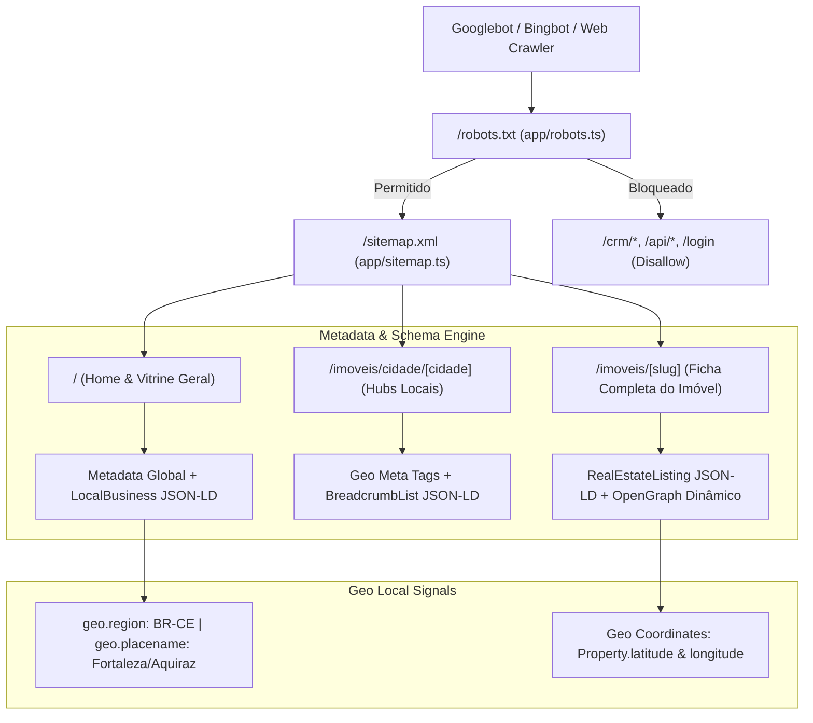

# Roadmap de Implementação: SEO Técnico, Geo SEO Local & Indexação Google (Connect Platz)

> **Status:** Planejamento Concluído • Branch: `feat/seo-geo-robots-google`  
> **Data:** Novembro de 2026  
> **Projeto:** Connect Platz CRM & Portal Imobiliário (Robson Carvalho)  
> **Objetivo:** Posicionar o portal no topo dos resultados de busca do Google (busca orgânica e Google Maps/Local Pack) para imóveis de venda e veraneio/temporada no Ceará (Fortaleza, Aquiraz, Eusébio, Caucaia e região metropolitana).

---

## 1. Diagnóstico do Estado Atual vs. Requisitos do Google

| Recurso | Estado Atual | Requisito para Alto Posicionamento no Google |
|---|---|---|
| **`robots.txt`** | ❌ Inexistente | `app/robots.ts` nativo Next.js: liberar páginas públicas (`/`, `/imoveis/*`, `/imovel/*`), bloquear rotas sensíveis (`/crm/*`, `/api/*`, `/login`), apontar URL canônica do `sitemap.xml`. |
| **`sitemap.xml`** | ❌ Inexistente | `app/sitemap.ts` dinâmico gerando URLs de todos os imóveis ativos do banco Prisma, páginas de cidades, bairros e rotas institucionais com `lastModified` e `priority`. |
| **Páginas Canônicas de Imóvel** | ⚠️ Redirecionamento por hash (`/?imovel=slug#vitrine`) | Páginas dedicadas SSR/ISR `/imoveis/[slug]` com metadados próprios, título específico, descrição enriquecida e tags OpenGraph dinâmicas por imóvel. |
| **Geo SEO (Local SEO)** | ❌ Sem coordenadas nem metadados geográficos | Meta tags `geo.position`, `geo.region` (BR-CE), `geo.placename` e coordenadas GPS no `<head>` e nos cards de imóveis. |
| **Dados Estruturados (Schema.org)** | ❌ Nenhum JSON-LD | JSON-LD para `RealEstateAgent`, `LocalBusiness`, `RealEstateListing`, `SingleFamilyResidence`, `ApartmentComplex`, `BreadcrumbList` e `FAQPage`. |
| **OpenGraph & Redes Sociais** | ⚠️ Apenas título padrão no `layout.tsx` | Metadados OG dinâmicos por página/imóvel com suporte a imagens de capa de alta resolução para WhatsApp, Facebook e Twitter Cards (`summary_large_image`). |
| **Indexabilidade & SSR** | ⚠️ `app/page.tsx` é 100% `"use client"` com fetch assíncrono | Shell Server-Side no App Router com metadata estático/dinâmico e pré-renderização de conteúdo chave para que o Googlebot capture HTML puro imediatamente. |
| **Search Console & Verificação** | ❌ Sem verificação configurada | Suporte a `google-site-verification` via `metadata.verification` parametrizável por `.env`. |

---

### 2. Dados Oficiais de Localização da Imobiliária (NAP & Geo Signals)

> **Nome Empresarial:** Connect Platz Imobiliária / Robson Carvalho  
> **CNPJ:** `53.758.699/0001-10` • **CRECI:** `023456-J`  
> **Endereço Completo:** Avenida Sargento Hermínio Sampaio, 5107, Antônio Bezerra, Fortaleza - CE, CEP 60356-640, Brasil  
> **Coordenadas Geográficas (GPS):** Latitude `-3.734236`, Longitude `-38.584945`  
> **Área de Atuação Primária:** Fortaleza, Aquiraz (Porto das Dunas/Prainha), Eusébio e Caucaia (Cumbuco).

---

## 3. Diagrama de Arquitetura de SEO & Indexação

---

## 3. Fases de Execução

### Fase 1: Fundação Técnica (`robots.ts`, `sitemap.ts` e Metadados Globais)
*Foco: Garantir que o Googlebot consiga rastrear o site com facilidade e indexar sem gastar crawl budget em rotas privadas.*

- [ ] **1.1. Gerador Nativo de Robots (`app/robots.ts`):**
  - Permitir acesso a `/`, `/imoveis`, `/imoveis/*`, `/espelho/*`.
  - Bloquear terminantemente `/crm`, `/crm/*`, `/api/*`, `/login`, `/_next/*`.
  - Apontar a diretiva `sitemap: https://connectplatz.com.br/sitemap.xml`.
- [ ] **1.2. Gerador Dinâmico de Sitemap (`app/sitemap.ts`):**
  - Consultar Prisma para recuperar todos os imóveis públicos com `isActive: true` e `exibirNaLandingPage: true`.
  - Gerar entradas com URL canônica, `lastModified` atualizado da propriedade, `changeFrequency: 'daily'` e `priority: 0.9` (para imóveis) e `1.0` (para a Home).
  - Incluir rotas estáticas e hubs de cidades principais (Fortaleza, Aquiraz, Eusébio, Caucaia).
- [ ] **1.3. Configuração de Canonical & Base URL em `app/layout.tsx`:**
  - Definir `metadataBase: new URL(process.env.NEXT_PUBLIC_APP_URL || 'https://connectplatz.com.br')`.
  - Configurar template de títulos: `title: { default: "Connect Platz | Imóveis de Alto Padrão e Veraneio", template: "%s | Connect Platz" }`.
  - Configurar verificação do Google Search Console: `verification: { google: process.env.NEXT_PUBLIC_GOOGLE_SITE_VERIFICATION }`.

---

### Fase 2: Geo SEO & Dados Estruturados (LocalBusiness & RealEstateAgent)
*Foco: Fazer a Connect Platz aparecer no Google Maps, Local Pack de busca imobiliária e pesquisas como "imóveis em Fortaleza", "casas de praia no Aquiraz", "aluguel temporada Porto das Dunas".*

- [ ] **2.1. Meta Tags Geográficas no `<head>`:**
  - `geo.region`: `BR-CE`
  - `geo.placename`: `Fortaleza, Ceará, Brasil`
  - `geo.position`: `-3.734236;-38.584945`
  - `ICBM`: `-3.734236, -38.584945`
- [ ] **2.2. Componente de JSON-LD LocalBusiness / RealEstateAgent:**
  - Criar `components/seo/OrganizationJsonLd.tsx`:
    - `@type`: `["RealEstateAgent", "LocalBusiness"]`
    - `name`: "Connect Platz Imobiliária"
    - `founder`: "Robson Carvalho"
    - `telephone`, `email`, `url`, `logo`, `image`.
    - `address`: `PostalAddress` ("Avenida Sargento Hermínio Sampaio, 5107", "Antônio Bezerra", "Fortaleza", "CE", "60356-640", "BR").
    - `geo`: `GeoCoordinates` (`latitude: -3.734236`, `longitude: -38.584945`).
    - `areaServed`: Lista de cidades atendidas (Fortaleza, Aquiraz, Eusébio, Caucaia).
    - `sameAs`: Links de redes sociais e WhatsApp.
- [ ] **2.3. Exibição do Endereço Completo no Rodapé (`PortalFooter`):**
  - Atualizar o rodapé do portal com o endereço físico oficial, fortalecendo a consistência de NAP (Name, Address, Phone) exigida pelo Google Search e Google Maps.
- [ ] **2.3. FAQPage Schema na Landing Page:**
  - Criar `components/seo/FaqJsonLd.tsx` com perguntas frequentes reais sobre compra de imóveis no Ceará, financiamento imobiliário e locação de veraneio por temporada. O Google destaca essas perguntas com rich snippets direto nos resultados de busca!

---

### Fase 3: Páginas Dedicadas de Imóveis (`/imoveis/[slug]`) & Server-Side SEO
*Foco: Cada imóvel publicado vira uma página indexável no Google, captando tráfego qualificado de pessoas buscando o nome exato do empreendimento ou condomínio.*

- [ ] **3.1. Rota Dinâmica Server-Rendered (`app/imoveis/[slug]/page.tsx`):**
  - Implementar função `generateMetadata({ params })`:
    - Título dinâmico: `${property.nome} em ${property.bairro}, ${property.cidade} | Connect Platz`
    - Descrição rica com diferenciais, metragem e valor formatado.
    - Imagem OpenGraph de capa do imóvel (`property.fotos[0]`).
    - Canonical link direto para `/imoveis/${property.slug}`.
  - Pré-renderização rápida com cache revalidado (`revalidate = 3600`).
- [ ] **3.2. JSON-LD de Imóvel (`RealEstateListing` & `Offer`):**
  - Criar `components/seo/PropertyJsonLd.tsx`:
    - `@type`: `SingleFamilyResidence` ou `ApartmentComplex` conforme o tipo.
    - `name`, `description`, `image`.
    - `geo`: coordenadas `latitude` e `longitude` salvas no cadastro do imóvel.
    - `address`: rua, bairro, cidade, estado, CEP.
    - `offers`: modalidade (venda ou diária de temporada), preço em BRL, disponibilidade.
- [ ] **3.3. BreadcrumbList Estruturado:**
  - Schema de navegação: `Início > Imóveis > ${cidade} > ${nomeDoImovel}` para exibir trilha de links limpa no snippet do Google.
- [ ] **3.4. Atualização Amigável do `app/espelho/[slug]`:**
  - Redirecionar `301 (Permanent Redirect)` de `/espelho/[slug]` para `/imoveis/[slug]`, garantindo que links antigos transfiram autoridade SEO.

---

### Fase 4: Otimização de Performance, Core Web Vitals & Compartilhamento
*Foco: Passar com nota verde no Google PageSpeed / Lighthouse (fator direto de ranqueamento).*

- [ ] **4.1. Otimização de Imagens:**
  - Garantir tags `alt` descritivas com palavras-chave locais (ex.: "Apartamento vista mar em Fortaleza - Fachada").
  - Dimensões explícitas `width` e `height` para zerar Cumulative Layout Shift (CLS).
- [ ] **4.2. Open Graph & Twitter Cards:**
  - Metadados universais para garantir que, ao compartilhar o link do site ou de um imóvel no WhatsApp, Telegram ou redes sociais, o card apareça com foto grande, título atraente e descrição comercial precisa.
- [ ] **4.3. Semântica HTML5:**
  - Validação estrita de tags `<header>`, `<main>`, `<article>`, `<nav>`, `<footer>` e hierarquia única de títulos (`<h1>` por página, `<h2>` para seções).

---

## 4. Checklist de Arquivos a Serem Criados / Modificados

| Arquivo | Ação | Responsabilidade |
|---|---|---|
| `app/robots.ts` | **Criar** | Instruções de rastreamento para Googlebot e Bingbot |
| `app/sitemap.ts` | **Criar** | Mapa do site dinâmico gerado a partir do banco Prisma |
| `app/layout.tsx` | **Modificar** | Metadados globais, `metadataBase`, OpenGraph e `OrganizationJsonLd` |
| `components/seo/OrganizationJsonLd.tsx` | **Criar** | Dados estruturados Schema.org para a imobiliária |
| `components/seo/PropertyJsonLd.tsx` | **Criar** | Dados estruturados Schema.org para imóveis individuais |
| `components/seo/BreadcrumbJsonLd.tsx` | **Criar** | Trilha de migalhas para snippets no Google |
| `app/imoveis/[slug]/page.tsx` | **Criar** | Página canônica do imóvel com SSR e `generateMetadata` |
| `app/espelho/[slug]/page.tsx` | **Modificar** | Redirecionamento 301 para a URL canônica `/imoveis/[slug]` |
| `.env.example` | **Modificar** | Adicionar `NEXT_PUBLIC_APP_URL` e `NEXT_PUBLIC_GOOGLE_SITE_VERIFICATION` |

---

## 5. Diretrizes de Qualidade e Boas Práticas

1. **Limite de Linhas (Regra do Projeto):** Nenhum novo arquivo excederá 350 a 400 linhas. As lógicas de Schema.org e metadados serão separadas em utilitários dedicados.
2. **Sem IA Externa / Código Determinístico:** Todos os cálculos e montagens de metadados são determinísticos com base nos dados do banco de dados e configurações.
3. **Validação Rich Results do Google:** Todos os schemas gerados devem estar em conformidade com as diretrizes do [Google Rich Results Test](https://search.google.com/test/rich-results).
